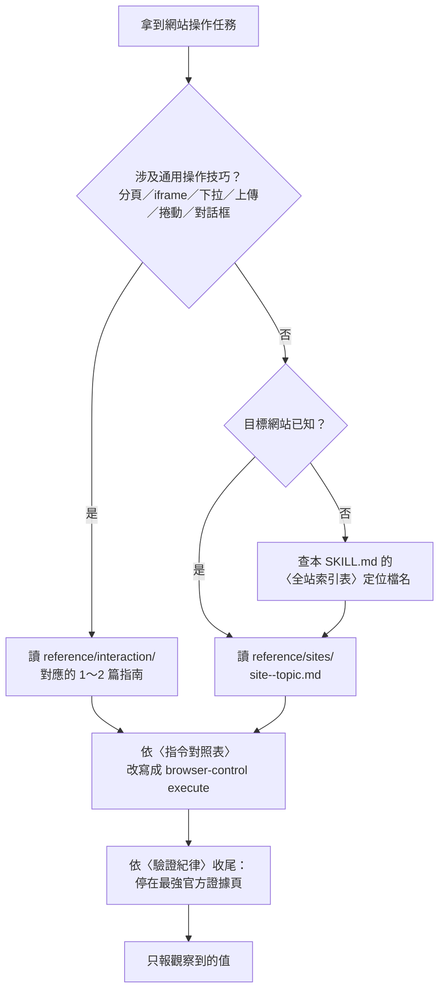

# Browser Site Guides — 網站操作與擷取指南庫

## 一、這個 skill 是什麼

這是一套**「網站專屬操作知識」**的參考庫，提供兩層內容：

| 層級 | 位置 | 內容 | 數量 |
|---|---|---|---|
| 互動指南（通用紀律） | `reference/interaction/` | 分頁、iframe、影子 DOM、下拉選單、上傳、捲動、對話框、列印 PDF、截圖、時效性、收尾證據頁…… | 20 篇 |
| 網站指南（逐站專屬） | `reference/sites/` | 每個網站的 URL 樣式、可用的選擇器、反爬／WAF 行為、登入需求、官方 API、已知陷阱 | 107 站／126 篇 |

內文**保留 keon/browser-control 原文**，只在每個檔案最上方加一段來源標註。

## 二、出處與授權

- 上游專案：**keon/browser-control**（Rust 寫的 CDP 瀏覽器 CLI）。
- 授權：**MIT License**，Copyright (c) 2026 Om Labs。全文見 [`LICENSE-keon.txt`](LICENSE-keon.txt)。
- 本 skill 的 `reference/` 內容為**改寫自**上述專案的 `skills/interaction-skills/` 與 `skills/domain-skills/`，**內文保留原文**（僅補上來源標註，並把少量敏感值改以佔位符表示）。
- 本 skill 的 `SKILL.md`（說明、指令對照表、索引、驗證紀律）為本 repo 新寫的繁體中文說明。

## 三、使用方式（按需載入，**不要一次全讀**）

具體步驟：

1. **先判斷需不需要互動指南。** 只要任務碰到「捲動後元素不見」「點不到 iframe 內的按鈕」「下拉選單打不開」「上傳沒反應」「對話框擋住」「要轉 PDF」等現象，就去 `reference/interaction/` 找對應那 1～2 篇讀完。
2. **再讀網站指南。** 依〈全站索引表〉找到 `reference/sites/<site>--<topic>.md`，讀該檔案；它會告訴你該站的 URL 樣式、可用的選擇器、是否需要登入、官方 API、以及已知陷阱。
3. **把上游指令改寫成本機寫法。** 上游指南裡的指令是 keon 那支 Rust CLI 的語法，**本機沒有那支 CLI**，請對照下方〈指令對照表〉與〈上游 Python 風格 helper 對照表〉改寫成 `browser-control execute`。
4. **收尾前執行〈驗證紀律〉。**

> **不要一次把 `reference/` 全部讀進來。** 那是 147 個檔案；每個任務實際需要的是 1～3 個。索引表存在的目的就是讓你**只挑需要的那一兩個**。

## 四、指令對照表

> **先讀這段**：本機環境**沒有** keon 的 `browser-control` CLI（那是 Rust 寫的 CDP 工具，走 `cargo install browser-control-cli`）。本機用的是 npm 套件 `@opencode-ai/browser-control` 0.8.4，透過 Playwright + extension relay 操作使用者**既有的** Chrome 分頁。
> 因此**左欄指令不可照抄執行**，只取語意；右欄才是本機可用的寫法。

| keon 指令 | 本機 browser-control 對應 |
|---|---|
| `browser-control launch <url>` | `browser-control execute 'await page.goto("<url>")'` |
| `browser-control open <url>` | `browser-control execute 'await page.goto("<url>")'` |
| `browser-control snapshot` | `browser-control execute 'return await snapshot()'` |
| `browser-control observe` | `browser-control execute 'return await snapshot({ delta: true })'`（要看最新可點元素用 `snapshot({ find: "...", context: 2 })`） |
| `browser-control inspect` | `browser-control execute 'return await snapshot()'`；需要完整 ARIA 樹時用 `ariaSnapshot()` |
| `browser-control text` | `browser-control execute 'return await page.evaluate(() => document.body.innerText)'` |
| `browser-control eval 'expr'` | `browser-control execute 'return await page.evaluate(() => expr)'` |
| `browser-control page-info` | `browser-control execute 'return { url: page.url(), title: await page.title() }'` |
| `browser-control click @e3` | `browser-control execute 'await ref("e3").click()'` |
| `browser-control click '#sel'` | `browser-control execute 'await page.locator("#sel").click()'` |
| `browser-control fill @e1 "x"` | `browser-control execute 'await ref("e1").fill("x")'`（原生 fill 被擋時改用 `fillInput(page.getByPlaceholder(...), "x")`） |
| `browser-control type "x"` | `browser-control execute 'await page.keyboard.type("x")'` |
| `browser-control press Enter` | `browser-control execute 'await page.keyboard.press("Enter")'` |
| `browser-control select '#c' US` | `browser-control execute 'await page.locator("#c").selectOption("US")'` |
| `browser-control scroll -- -300 0` | `browser-control execute 'await page.mouse.wheel(0, -300)'` |
| `browser-control drag 10,10 200,200` | `browser-control execute 'await page.mouse.move(10,10); await page.mouse.down(); await page.mouse.move(200,200); await page.mouse.up()'` |
| `browser-control wait load 10` | `await page.waitForLoadState("load", {timeout:10000})` |
| `browser-control wait-element '#x' 10` | `await page.locator('#x').waitFor({timeout:10000})` |
| `browser-control screenshot out.png` | `await page.screenshot({path:"out.png"})`（要看版面用 `screenshotWithLabels({ page })`） |
| `browser-control upload '#f' a.pdf` | `await page.locator('#f').setInputFiles("a.pdf")` |
| `browser-control pdf page.pdf` | `execute` 內用 `page.context().newCDPSession(page)` 呼叫 CDP `Page.printToPDF` |
| `browser-control tabs` / `new-tab` | `browser-control session new "<名稱>"` + `page`；接手使用者已開的分頁用 `browser-control session adopt` |
| `browser-control switch-tab` / `close-tab` | `execute` 內用 `context.pages()` 切換；刪除用 `page.close()` |
| `browser-control network` | `browser-control network start/status/stop --session <id>`（輸出會自動遮蔽憑證） |
| `browser-control cdp <Method>` | `execute` 內用 `page.context().newCDPSession(page)` |
| `browser-control download` | 0.8.4 不支援攔截；改用頁面 `fetch` + Node `fs` 寫檔 |
| `browser-control http-get <url>` | `browser-control execute 'return await page.evaluate(async (u) => (await fetch(u)).text(), "<url>")'`（同源時會帶 cookie） |
| `browser-control cookies` | `browser-control execute 'return await context.cookies()'` |
| `browser-control dialog accept` | `browser-control execute 'page.on("dialog", d => d.accept())'`（須在觸發前掛上） |
| `browser-control viewport 1280 720` | `browser-control execute 'await page.setViewportSize({ width: 1280, height: 720 })'` |
| `browser-control status` / `doctor` | `browser-control status --json` / `browser-control doctor` |
| `browser-control init` / `stop` / `reload` | 本機由 relay 管理，不需手動啟停；`reload` 用 `await page.reload()` |
| `browser-control sync-profile` / `cloud-*` | 本機 0.8.4 無對應子指令；雲端情境請改用 `network` 擷取後自行呼叫 API |
| `browser-control run <script>` / `--from-stdin` | `browser-control execute --file ./<script>.js`（多步驟建議合併在同一支 execute） |
| **（本機沒有這個 CLI）** | **本機環境並沒有 keon 的 `browser-control` CLI**（那是 Rust 寫的 CDP 工具）。本機用的是 npm 套件 `@opencode-ai/browser-control` 0.8.4，走 Playwright + extension relay。因此上表左欄的指令**不可照抄執行**，請只取其語意，右欄才是本機可用的寫法。** |

### 上游 Python 風格 helper 對照表

網站指南裡的程式碼片段常直接呼叫 keon 執行環境提供的 Python helper（例如 `http_get(...)`、`js(...)`、`goto_url(...)`）。本機沒有這層環境，對應如下：

| 上游 helper | 本機對應 |
|---|---|
| `http_get(url)` | `await page.evaluate(async (u) => (await fetch(u)).text(), url)`（同源帶 cookie）／跨網域用 Node 端 `fetch` |
| `js("...")` | `return await page.evaluate(() => { /* 原 JS 內容 */ })` |
| `goto_url(url)` | `await page.goto(url)` |
| `wait_for_load()` | `await page.waitForLoadState("load")` |
| `wait(n)` | `await page.waitForTimeout(n * 1000)` |
| `click(sel)` / `click_at_xy(x, y)` | `await page.locator(sel).click()` ／ `await page.mouse.click(x, y)` |
| `type_text("...")` | `await page.keyboard.type("...")` |
| `capture_screenshot(path)` | `await page.screenshot({ path })` |
| `new_tab(url)` / `switch_tab(i)` | `await context.newPage()` ／ 在 `context.pages()` 中切換 |
| `select(sel, value)` | `await page.locator(sel).selectOption(value)` |
| `cdp(method, params)` | `const s = await page.context().newCDPSession(page); await s.send(method, params)` |

## 五、全站索引表

### 5.1 互動指南（20 篇，優先讀）

| 指南 | 參考檔案 | 用途摘要 |
|---|---|---|
| `connection` | [`connection.md`](reference/interaction/connection.md) | 連線與高效 CLI 使用：批次執行、避免無謂開分頁、refs 失效時的處理 |
| `cookies` | [`cookies.md`](reference/interaction/cookies.md) | Cookie 的讀取、保存與寫入；分清瀏覽器狀態與頁面狀態 |
| `cross-origin-iframes` | [`cross-origin-iframes.md`](reference/interaction/cross-origin-iframes.md) | 跨來源 iframe：target 掛接、附件式操作與何時改用座標點擊 |
| `dialogs` | [`dialogs.md`](reference/interaction/dialogs.md) | alert／confirm／prompt／beforeunload 等瀏覽器對話框的兩種處理時機 |
| `downloads` | [`downloads.md`](reference/interaction/downloads.md) | 區分「瀏覽器觸發的下載」與「直接 http_get 抓檔」，以及下載已啟動的判據 |
| `drag-and-drop` | [`drag-and-drop.md`](reference/interaction/drag-and-drop.md) | 拖放：低階輸入事件 vs 檔案上傳 vs 特定 DOM 拖放序列的取捨 |
| `dropdowns` | [`dropdowns.md`](reference/interaction/dropdowns.md) | 下拉選單四型：原生 select、自訂 overlay、可搜尋 combobox、虛擬清單 |
| `evidence-page` | [`evidence-page.md`](reference/interaction/evidence-page.md) | 離開前把瀏覽器停在最強的官方可見證據頁（收尾紀律） |
| `final-answer` | [`final-answer.md`](reference/interaction/final-answer.md) | 最終答案契約：15 項必查條件與「尚未可收尾」的紅旗清單 |
| `freshness` | [`freshness.md`](reference/interaction/freshness.md) | 時效性紀律：把相對日期換算成具體日期、只在視窗內挑選、交叉比對 |
| `iframes` | [`iframes.md`](reference/interaction/iframes.md) | 同源 iframe 的 contentDocument／contentWindow 走訪與座標換算陷阱 |
| `network-requests` | [`network-requests.md`](reference/interaction/network-requests.md) | 網路請求觀察與靜態抓取：何時改看 XHR／fetch 而非 DOM |
| `print-as-pdf` | [`print-as-pdf.md`](reference/interaction/print-as-pdf.md) | 產生 PDF 的兩條路：直接 CDP printToPDF vs 走網站「Print」按鈕 |
| `profile-sync` | [`profile-sync.md`](reference/interaction/profile-sync.md) | 把本機 Chrome profile 的 cookie 上傳，讓遠端瀏覽器自帶登入狀態 |
| `screenshots` | [`screenshots.md`](reference/interaction/screenshots.md) | 截圖與裝置像素／CSS 像素比例，避免放大裁切冒充 HD |
| `scrolling` | [`scrolling.md`](reference/interaction/scrolling.md) | 確定性捲動指令與精簡的捲動後檢查 |
| `shadow-dom` | [`shadow-dom.md`](reference/interaction/shadow-dom.md) | shadowRoot 遞迴穿透，以及何時改用座標點擊比較省事 |
| `tabs` | [`tabs.md`](reference/interaction/tabs.md) | 分頁：CDP 負責控制、UI 自動化負責可見順序 |
| `uploads` | [`uploads.md`](reference/interaction/uploads.md) | 檔案上傳：setInputFiles 與各站點特定上傳元件的差異 |
| `viewport` | [`viewport.md`](reference/interaction/viewport.md) | 視窗尺寸變更對版面、座標點擊與流程穩定性的影響 |

### 5.2 網站指南（107 站）

| 網站 | 參考檔名 | 一句話用途 |
|---|---|---|
| `BOSS-zhipin` | [`BOSS-zhipin--chat.md`](reference/sites/BOSS-zhipin--chat.md)、[`BOSS-zhipin--job-search.md`](reference/sites/BOSS-zhipin--job-search.md)、[`BOSS-zhipin--navigation.md`](reference/sites/BOSS-zhipin--navigation.md) | BOSS 直聘求職搜尋、聊天訊息與站內導覽 |
| `aa` | [`aa--checkout.md`](reference/sites/aa--checkout.md) | 美國航空（aa.com）訪客訂位結帳，一路推進到信用卡輸入表單 |
| `agentlist` | [`agentlist--discovery.md`](reference/sites/agentlist--discovery.md) | AgentList 技能／代理／MCP 目錄的探索、列表與細節抓取 |
| `alaska` | [`alaska--checkout.md`](reference/sites/alaska--checkout.md) | 阿拉斯加航空訪客訂位結帳（免登入，停在付款前） |
| `allrecipes` | [`allrecipes--recipe-extraction.md`](reference/sites/allrecipes--recipe-extraction.md) | Allrecipes 食譜搜尋與 JSON-LD 結構化擷取（評分、食材、步驟、營養） |
| `amazon` | [`amazon--product-search.md`](reference/sites/amazon--product-search.md)、[`amazon--retail-workflows.md`](reference/sites/amazon--retail-workflows.md) | 亞馬遜商品搜尋與零售購物流程（卡片選擇器、評價數、排序） |
| `apple` | [`apple--product-store-support.md`](reference/sites/apple--product-store-support.md)、[`apple--scraping.md`](reference/sites/apple--scraping.md) | Apple 官網產品頁、Store、Support 與 Newsroom 的官方擷取 |
| `archive-org` | [`archive-org--scraping.md`](reference/sites/archive-org--scraping.md) | Internet Archive／Wayback Machine 的項目與快照資料擷取 |
| `articulate-rise` | [`articulate-rise--code-blocks.md`](reference/sites/articulate-rise--code-blocks.md) | Articulate Rise 360 課程編輯、預覽與沙箱化程式碼區塊操作 |
| `arxiv` | [`arxiv--paper-search.md`](reference/sites/arxiv--paper-search.md)、[`arxiv--scraping.md`](reference/sites/arxiv--scraping.md) | arXiv 論文搜尋與 Atom API 擷取（含進階搜尋與分頁） |
| `arxiv-bulk` | [`arxiv-bulk--scraping.md`](reference/sites/arxiv-bulk--scraping.md) | arXiv OAI-PMH 批次採集＋Semantic Scholar 引用補完 |
| `atlas` | [`atlas--overview.md`](reference/sites/atlas--overview.md) | Atlas 招募平台的路由、篩選器與 GraphQL 引導 |
| `bbc-news` | [`bbc-news--news-audio.md`](reference/sites/bbc-news--news-audio.md) | BBC 新聞（最新頭條、音訊稿）的擷取與時效判斷 |
| `bigbang-hr` | [`bigbang-hr--checkout.md`](reference/sites/bigbang-hr--checkout.md) | Bigbang 線上商城結帳流程與 GTM／GA4 DataLayer 觀測 |
| `bilibili` | [`bilibili--navigation.md`](reference/sites/bilibili--navigation.md) | Bilibili 站內導覽、影片頁結構與長按互動 |
| `booking-com` | [`booking-com--hotel-booking.md`](reference/sites/booking-com--hotel-booking.md)、[`booking-com--scraping.md`](reference/sites/booking-com--scraping.md) | Booking.com 飯店搜尋、參數掉包復原與頁面擷取 |
| `browser-use-cloud` | [`browser-use-cloud--cleanup-zombies.py`](reference/sites/browser-use-cloud--cleanup-zombies.py)、[`browser-use-cloud--cloud.md`](reference/sites/browser-use-cloud--cloud.md) | Browser Use 雲端瀏覽器 REST 操作與殘留 session 清理腳本 |
| `cambridge-dictionary` | [`cambridge-dictionary--dictionary-grammar.md`](reference/sites/cambridge-dictionary--dictionary-grammar.md) | 劍橋字典查詞、音標、詞形與文法頁擷取 |
| `capterra` | [`capterra--scraping.md`](reference/sites/capterra--scraping.md) | Capterra 軟體評價（用 ClaudeBot UA 直接取得 Markdown 輸出） |
| `centilebrain` | [`centilebrain--generate-estimates.md`](reference/sites/centilebrain--generate-estimates.md) | CentileBrain 常模模型偏差值（生成常模百分位）計算 |
| `claude-ai` | [`claude-ai--share-export.md`](reference/sites/claude-ai--share-export.md) | claude.ai 分享對話的匯出（分享頁與逐字稿） |
| `coingecko` | [`coingecko--scraping.md`](reference/sites/coingecko--scraping.md) | CoinGecko 幣價、市值、歷史與合約地址資料 |
| `coinmarketcap` | [`coinmarketcap--scraping.md`](reference/sites/coinmarketcap--scraping.md) | CoinMarketCap 加密市價、市值排行與內部 JSON API |
| `coursera` | [`coursera--course-catalog.md`](reference/sites/coursera--course-catalog.md)、[`coursera--scraping.md`](reference/sites/coursera--scraping.md) | Coursera 課程目錄、課程頁評分與公開目錄 API |
| `craigslist` | [`craigslist--scraping.md`](reference/sites/craigslist--scraping.md) | Craigslist 二手／租售清單的純 HTTP 擷取 |
| `crossref` | [`crossref--scraping.md`](reference/sites/crossref--scraping.md) | CrossRef DOI 與引用中繼資料（免金鑰 API） |
| `ctrip` | [`ctrip--hotels.md`](reference/sites/ctrip--hotels.md) | 攜程（ctrip.com）飯店搜尋與價格擷取 |
| `dev-to` | [`dev-to--scraping.md`](reference/sites/dev-to--scraping.md) | DEV Community 文章、標籤與使用者資料（公開 REST API） |
| `duckduckgo` | [`duckduckgo--scraping.md`](reference/sites/duckduckgo--scraping.md) | DuckDuckGo Instant Answer API 的各種查詢與回應格式 |
| `ebay` | [`ebay--scraping.md`](reference/sites/ebay--scraping.md) | eBay 商品、賣家與類目資料擷取 |
| `espn` | [`espn--sports-research.md`](reference/sites/espn--sports-research.md) | ESPN 賽事、戰績、排名與賽程資料 |
| `etsy` | [`etsy--scraping.md`](reference/sites/etsy--scraping.md) | Etsy 手作商品擷取與 DataDome 驗證觀察 |
| `eventbrite` | [`eventbrite--scraping.md`](reference/sites/eventbrite--scraping.md) | Eventbrite 活動列表與票務資料（公開頁＋OAuth API） |
| `expedia` | [`expedia--automation.md`](reference/sites/expedia--automation.md) | Expedia 訂房流程的瀏覽器自動化 |
| `facebook` | [`facebook--groups.md`](reference/sites/facebook--groups.md)、[`facebook--pages.md`](reference/sites/facebook--pages.md) | Facebook 社團與專頁貼文串的挖掘（需已登入） |
| `flipkart` | [`flipkart--shopping.md`](reference/sites/flipkart--shopping.md) | Flipkart 商品搜尋與購物（禮物）流程自動化 |
| `framer` | [`framer--editor.md`](reference/sites/framer--editor.md) | Framer 網頁編輯器 DOM、Monaco 程式碼編輯與發布流程 |
| `fred` | [`fred--scraping.md`](reference/sites/fred--scraping.md) | FRED 聯準會總體經濟時間序列（CSV／JSON／免金鑰備援） |
| `g2` | [`g2--scraping.md`](reference/sites/g2--scraping.md) | G2 B2B 軟體評價、類別與廠商資料 |
| `genius` | [`genius--scraping.md`](reference/sites/genius--scraping.md) | Genius 歌詞、歌曲與藝人資料擷取 |
| `github` | [`github--github-research.md`](reference/sites/github--github-research.md)、[`github--repo-actions.md`](reference/sites/github--repo-actions.md)、[`github--scraping.md`](reference/sites/github--scraping.md) | GitHub 研究、repo 動作（star／watch 表單）與 API 擷取 |
| `glassdoor` | [`glassdoor--scraping.md`](reference/sites/glassdoor--scraping.md) | Glassdoor 公司資料、評論、職缺與薪資 |
| `gmail` | [`gmail--compose.md`](reference/sites/gmail--compose.md) | Gmail 撰寫、收件人與寄送流程 |
| `goodreads` | [`goodreads--scraping.md`](reference/sites/goodreads--scraping.md) | Goodreads 書籍、版本與評分資料 |
| `google-flights` | [`google-flights--flight-search.md`](reference/sites/google-flights--flight-search.md)、[`google-flights--scraping.md`](reference/sites/google-flights--scraping.md) | Google Flights 航班搜尋（SPA 互動）與結果擷取 |
| `google-maps` | [`google-maps--maps-reviews.md`](reference/sites/google-maps--maps-reviews.md)、[`google-maps--scraping.md`](reference/sites/google-maps--scraping.md) | Google Maps 地點、評論、路線與分店資訊 |
| `google-search` | [`google-search--scraping.md`](reference/sites/google-search--scraping.md)、[`google-search--source-verification.md`](reference/sites/google-search--source-verification.md) | Google 搜尋策略與來源查證（避免異常流量封鎖） |
| `gutenberg` | [`gutenberg--scraping.md`](reference/sites/gutenberg--scraping.md) | Project Gutenberg 電子書全文與中繼資料 |
| `hackernews` | [`hackernews--scraping.md`](reference/sites/hackernews--scraping.md) | Hacker News 連結聚合、留言與 Firebase／Algolia API |
| `howlongtobeat` | [`howlongtobeat--scraping.md`](reference/sites/howlongtobeat--scraping.md) | HowLongToBeat 遊戲通關時數資料 |
| `hubspot` | [`hubspot--private-app-webhooks.md`](reference/sites/hubspot--private-app-webhooks.md) | HubSpot Private App 的 webhook 訂閱編輯與驗證 |
| `huggingface` | [`huggingface--model-hub.md`](reference/sites/huggingface--model-hub.md) | Hugging Face 模型／資料集中樞（Model Hub） |
| `imdb` | [`imdb--scraping.md`](reference/sites/imdb--scraping.md) | IMDb 排行榜、搜尋與「More Like This」擷取 |
| `itch-io` | [`itch-io--scraping.md`](reference/sites/itch-io--scraping.md) | itch.io 遊戲頁與開發者作品擷取 |
| `job-boards` | [`job-boards--indeed-glassdoor.md`](reference/sites/job-boards--indeed-glassdoor.md) | Indeed／Glassdoor／Stepstone 等職缺板塊操作 |
| `letterboxd` | [`letterboxd--scraping.md`](reference/sites/letterboxd--scraping.md) | Letterboxd 電影、日記、評分與使用者頁擷取 |
| `linkedin` | [`linkedin--invitation-manager.md`](reference/sites/linkedin--invitation-manager.md) | LinkedIn 好友邀請批次管理（接受／忽略） |
| `loom` | [`loom--folder-enumeration.md`](reference/sites/loom--folder-enumeration.md) | Loom 私人工作區的資料夾列舉 |
| `ly-com` | [`ly-com--hotels.md`](reference/sites/ly-com--hotels.md) | 同程（ly.com）飯店搜尋與價格擷取 |
| `macrotrends` | [`macrotrends--scraping.md`](reference/sites/macrotrends--scraping.md) | Macrotrends 長期財務與經濟圖表資料 |
| `manus` | [`manus--tasks.md`](reference/sites/manus--tasks.md) | Manus 任務提交、等待完成與結果分享 |
| `medium` | [`medium--article-hydration.md`](reference/sites/medium--article-hydration.md)、[`medium--scraping.md`](reference/sites/medium--scraping.md) | Medium 文章內文（DOM）擷取與 API／GraphQL 路徑 |
| `metacritic` | [`metacritic--scraping.md`](reference/sites/metacritic--scraping.md) | Metacritic 遊戲／電影／電視劇評分與評論 |
| `musicbrainz` | [`musicbrainz--scraping.md`](reference/sites/musicbrainz--scraping.md) | MusicBrainz 音樂百科（藝人、專輯、曲目、封面） |
| `nasa` | [`nasa--scraping.md`](reference/sites/nasa--scraping.md) | NASA 開放 API 天文與地球資料 |
| `news-aggregation` | [`news-aggregation--multi-source.md`](reference/sites/news-aggregation--multi-source.md) | 多來源新聞彙整（多家媒體一次掃過的策略） |
| `open-library` | [`open-library--scraping.md`](reference/sites/open-library--scraping.md) | Open Library 書籍目錄與版本資料 |
| `openalex` | [`openalex--scraping.md`](reference/sites/openalex--scraping.md) | OpenAlex 學術知識圖譜（作品、作者、機構） |
| `openstreetmap` | [`openstreetmap--scraping.md`](reference/sites/openstreetmap--scraping.md) | OpenStreetMap Nominatim 地理編碼與 Overpass 查詢 |
| `package-registries` | [`package-registries--npm-pypi.md`](reference/sites/package-registries--npm-pypi.md) | npm 與 PyPI 套件登錄資料與下載量統計 |
| `perplexity` | [`perplexity--computer.md`](reference/sites/perplexity--computer.md) | Perplexity Computer 儀表板、任務執行、成果與分享 |
| `polymarket` | [`polymarket--scraping.md`](reference/sites/polymarket--scraping.md) | Polymarket 市場資料、結果與留言（selector 敵對 DOM） |
| `producthunt` | [`producthunt--scraping.md`](reference/sites/producthunt--scraping.md) | Product Hunt 產品、榜單與標籤擷取 |
| `pubmed` | [`pubmed--scraping.md`](reference/sites/pubmed--scraping.md) | PubMed／NCBI E-utilities 生醫文獻擷取 |
| `qbo` | [`qbo--report-export.md`](reference/sites/qbo--report-export.md) | QuickBooks Online 自訂報表的 PDF 匯出（blob 抓取） |
| `quora` | [`quora--scraping.md`](reference/sites/quora--scraping.md) | Quora 問答、話題與使用者頁擷取 |
| `rawg` | [`rawg--scraping.md`](reference/sites/rawg--scraping.md) | RAWG 遊戲資料庫（遊戲、平台、發行商） |
| `reddit` | [`reddit--scraping.md`](reference/sites/reddit--scraping.md) | Reddit 貼文與留言擷取（web components 結構） |
| `rest-countries` | [`rest-countries--scraping.md`](reference/sites/rest-countries--scraping.md) | REST Countries 國家、貨幣、語言與區域資料 |
| `salesforce` | [`salesforce--placeholder.md`](reference/sites/salesforce--placeholder.md) | 上游僅保留空白佔位檔，尚無實質指南 |
| `sec-edgar` | [`sec-edgar--scraping.md`](reference/sites/sec-edgar--scraping.md) | SEC EDGAR 申報文件、公司與 XBRL 財務資料 |
| `shopify-admin` | [`shopify-admin--README.md`](reference/sites/shopify-admin--README.md)、[`shopify-admin--embedded-apps.md`](reference/sites/shopify-admin--embedded-apps.md)、[`shopify-admin--knowledge-base.md`](reference/sites/shopify-admin--knowledge-base.md)、[`shopify-admin--polaris-inputs.md`](reference/sites/shopify-admin--polaris-inputs.md) | Shopify Admin 內嵌 App、知識庫 App 與 Polaris 輸入框 |
| `soundcloud` | [`soundcloud--scraping.md`](reference/sites/soundcloud--scraping.md) | SoundCloud 曲目、藝人與播放清單擷取 |
| `spotify` | [`spotify--scraping.md`](reference/sites/spotify--scraping.md) | Spotify 曲目、藝人、專輯與內嵌 client id 擷取 |
| `spreadshirt` | [`spreadshirt--placeholder.md`](reference/sites/spreadshirt--placeholder.md) | 上游僅保留空白佔位檔，尚無實質指南 |
| `stackoverflow` | [`stackoverflow--scraping.md`](reference/sites/stackoverflow--scraping.md) | Stack Overflow 問答、標籤與使用者資料 |
| `steam` | [`steam--scraping.md`](reference/sites/steam--scraping.md) | Steam 遊戲商店、價格與評價資料 |
| `substack` | [`substack--scraping.md`](reference/sites/substack--scraping.md) | Substack 文章、RSS 與刊物訂閱資料 |
| `tasksquad-ai` | [`tasksquad-ai--agents.md`](reference/sites/tasksquad-ai--agents.md)、[`tasksquad-ai--auth.md`](reference/sites/tasksquad-ai--auth.md)、[`tasksquad-ai--tasks.md`](reference/sites/tasksquad-ai--tasks.md) | TaskSquad 認證、任務收件匣與代理管理 |
| `thetechgeeks` | [`thetechgeeks--pricing.md`](reference/sites/thetechgeeks--pricing.md) | The Tech Geeks AU（Ubiquiti 經銷商）價格頁擷取 |
| `tiktok` | [`tiktok--upload.md`](reference/sites/tiktok--upload.md) | TikTok Studio 影片上傳流程與草稿提示處理 |
| `tradingview` | [`tradingview--scraping.md`](reference/sites/tradingview--scraping.md) | TradingView 圖表、篩選器與標的搜尋資料 |
| `trello` | [`trello--boards-and-lists.md`](reference/sites/trello--boards-and-lists.md) | Trello 看板、清單與卡片（唯讀）擷取 |
| `trustpilot` | [`trustpilot--scraping.md`](reference/sites/trustpilot--scraping.md) | Trustpilot 公司評論與評分擷取 |
| `vercel` | [`vercel--vercel.md`](reference/sites/vercel--vercel.md) | Vercel Dashboard 的瀏覽器操作 |
| `walmart` | [`walmart--scraping.md`](reference/sites/walmart--scraping.md) | Walmart 商品搜尋與資料擷取 |
| `wayback-machine` | [`wayback-machine--scraping.md`](reference/sites/wayback-machine--scraping.md) | Wayback Machine CDX API 與快照內容抓取 |
| `weather` | [`weather--scraping.md`](reference/sites/weather--scraping.md) | wttr.in／Open-Meteo／weather.gov 等免金鑰天氣 API |
| `wehotel` | [`wehotel--hotels.md`](reference/sites/wehotel--hotels.md) | 錦江 WeHotel（bestwehotel.com）飯店搜尋與擷取 |
| `wellfound` | [`wellfound--scraping.md`](reference/sites/wellfound--scraping.md) | Wellfound（AngelList）新創職缺與公司資料 |
| `weread` | [`weread--read.md`](reference/sites/weread--read.md) | WeRead 微信讀書的自動閱讀流程 |
| `wolfram-alpha` | [`wolfram-alpha--computation-results.md`](reference/sites/wolfram-alpha--computation-results.md) | Wolfram Alpha 計算結果 pod（含圖片 alt）擷取 |
| `world-bank` | [`world-bank--scraping.md`](reference/sites/world-bank--scraping.md) | World Bank 開放資料 API（全球發展指標） |
| `x` | [`x--posting.md`](reference/sites/x--posting.md) | X（Twitter）發文與登入流程（FedCM 限制與人工接手） |
| `xiaohongshu` | [`xiaohongshu--scraping.md`](reference/sites/xiaohongshu--scraping.md) | 小紅書搜尋結果頁導覽與排序操作 |
| `youtube` | [`youtube--scraping.md`](reference/sites/youtube--scraping.md) | YouTube 影片、頻道、字幕與搜尋資料 |
| `zillow` | [`zillow--scraping.md`](reference/sites/zillow--scraping.md) | Zillow 房價與房產資料擷取 |

## 六、驗證紀律

以下三篇是本庫的**收尾紀律**，每次任務結束前都要套用（原文見 `reference/interaction/` 對應檔案）：

### 6.1 停在最強的官方證據頁 — `reference/interaction/evidence-page.md`

- **離開前把瀏覽器停在最能證明答案的那一頁**：單一物件的**細節頁**、仍看得到篩選條件的**結果頁**、或顯示「已完成／被擋」的**確認頁**。
- **不要停在**：泛用首頁、寬鬆的搜尋頁、無關分頁、cookie 橫幅、空白頁、過期路由，或**畫面與答案互相矛盾**的頁面。
- 比較／Top-N 任務，保留結果清單或多張可見卡片，通常比只留一張細節頁更有力。
- 單一物件任務，能開細節頁就開。
- **若被擋**（登入、付費、機器人防護、地區上架、站方政策）：停在**官方阻擋頁**或**最後一個能證明邊界的官方頁**，並在答案裡說明這個 blocker。
- 收尾前確認目前分頁的標題／URL／可見文字**仍然支持**你的答案；不確定時用 `page.url()`、`snapshot()` 或截圖複查。

### 6.2 只報觀察到的值 — `reference/interaction/final-answer.md`

出 `FINAL ANSWER:` 前逐項確認，任一項不過就**繼續找**，不要硬答：

| # | 檢查項 | 失敗的樣貌 |
|---|---|---|
| 1 | 對象精確 | 答的是別的網站／類別／篩選／型號／日期 |
| 2 | 欄位齊全 | 漏掉被要求的價格、數量、日期、評分、來源 |
| 3 | **只報觀察到的值** | 名稱／型號／頁面是「從記憶補上來的」 |
| 4 | 相對日期已換算 | 只寫「上週」沒寫具體日期 |
| 5 | 清單與數量 | 只報第一頁數量卻當成總數 |
| 6 | 動作任務說清楚 | 只解釋「怎麼做」沒說「做了沒」 |
| 7 | 硬條件全過 | 選到的項目其實不符某個門檻 |
| 8 | 沒有偷偷替換 | 用「相近的」替代被要求的對象 |
| 9 | 分清 blocker | 走到結帳頁 ≠ 完成下單 |
| 10 | 來源面正確 | 該用規格頁卻用行銷文案 |
| 11 | 時序合理 | 把未來排程講成已完成 |
| 12 | 門檻有數據 | 「超過 4 星」但沒附觀察到的數值 |
| 13 | 沒猜網址 | 網址開得起來**不等於**該頁存在 |
| 14 | 狀態還在 | SPA 把日期／地點／人數參數掉了 |
| 15 | 子型別鎖定 | 指定的子型別／頁面沒被選到 |

**紅旗（看到就不要收尾）**：只說「結果頁載入了」／缺被選項名稱／值來自記憶而非頁面／「最新」答非所問卻沒說明／相對日期沒換算／直接搜尋網址掉了參數未補正／以抽樣數量冒充總數／「查無結果」但只查了一頁／把不符硬條件的備案當主答案。

### 6.3 相對日期要換算成具體日期 — `reference/interaction/freshness.md`

- 任務文字是**權威日期錨點**：有明確日期就用它，即使與執行日不同。
- 任務只有相對日期（「昨天」「最近兩天」「上週」「最新」「接下來」）→ **先換算成具體日期**再搜尋，並在答案中寫出這個區間。
- **只報視窗內的項目**：落在區間外的就繼續找或明說沒有符合者，**不可默默放寬視窗**。
- **未來排程 ≠ 已完成**；「現在／最新」不可拿舊文章冒充，除非官方頁面就標示它是最新的可見結果。
- 官方頁面與記憶中的舊值衝突時，**以當下官方證據為準**，並附上觀察到的日期／來源標籤。
- 若直接網址或搜尋頁掉了查詢參數，**補填一次並重新確認**後再相信結果。
- 收尾 gate：日期區間已具體化 → 回傳項目確實落在區間內 → 來源就是任務要求的來源 → 篩選／排序有官方依據 → 措辭分得清「即時答案」與「歷史／靜態答案」。

## 七、已知限制

| 限制 | 影響 | 處置 |
|---|---|---|
| 本機沒有 keon 的 `browser-control` CLI | 上游指南內文出現的 `browser-control ` 指令**不能直接跑** | 一律改寫成 `browser-control execute ...`，見〈指令對照表〉 |
| 本機 0.8.4 不支援攔截下載事件 | `page.waitForEvent("download")` 攔不到 `Content-Disposition` 附件 | 改用頁面 `fetch` 取位元組，再以 Node `fs` 寫檔 |
| 網站指南是「某一天的實測」 | 選擇器與版面可能已變 | 以本機 `snapshot()` 重新取得 refs，不要盲信文件裡的舊 ref |
| 網站指南含即時性內容（價格、榜單、新聞） | 答案會過期 | 套用〈驗證紀律〉6.3，重新觀察當下頁面 |
| 部分網站需登入或有人機驗證 | 無法完全自動化 | 依本 repo `browser-control` skill 的 `handoff()` 流程交給使用者完成 |

## 附錄：本機執行紀律（摘自本 repo 的 `browser-control` skill）

- **inspect → act → verify**：先 `return await snapshot()` 讀真實頁面再選定位器；點擊成功**不等於**任務成功。
- refs 會隨導覽／DOM 漂移失效；看到 `not found: eNN` 時**只做一次**新的 snapshot 並改用新 ref，不要重試舊 ref。
- 表單送出／對外動作要**先登記預期導覽**，點一次，再讀目的地與收據；送出逾時或讀不到目的地時報「**未驗證**」，**絕不重播**不確定的送出／下單／付款。
- 需要人完成的步驟（2FA、passkey、CAPTCHA、付款確認）用 `handoff()`；人的點頭**不是驗證**，仍要斷言預期的 URL 或元素。
- 密碼欄位的值不要寫進 execute 原始碼或日誌。
