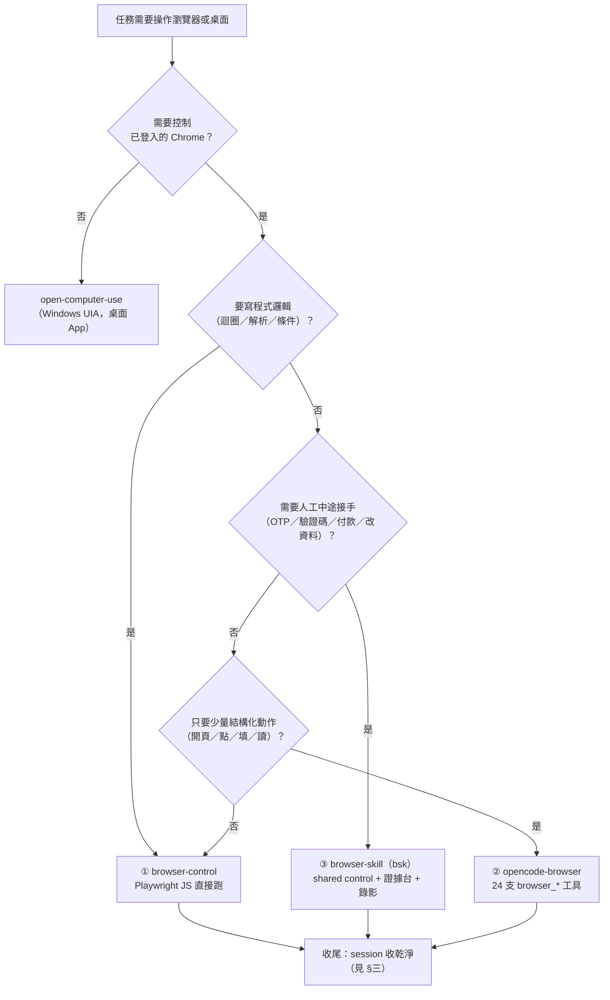
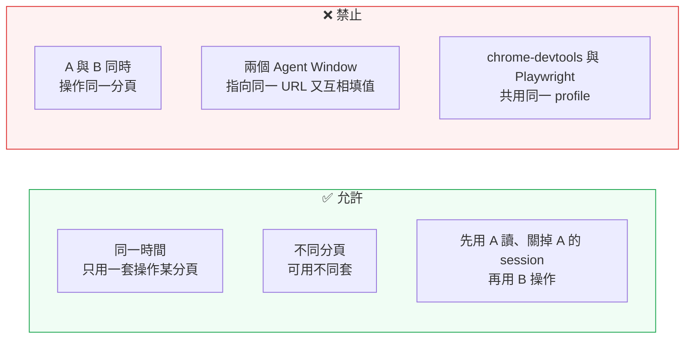

# browser-stack-routing — 本機瀏覽器自動化的「選軌」與「避碰」

本機同時存在**五套**可操作瀏覽器／桌面的工具。它們各自能動，但**同時動同一個分頁會互相踩**。
本 skill 只做兩件事：**(1) 選對那一套 (2) 講清楚不能同時用**。

> 各套的詳細操作請載入各自的 skill，本 skill 不重複教學：
> `browser-control`、`opencode-browser`、`browser-skill`、`open-computer-use`。

---

## 一、30 秒決策



**一句話版**：要**彈性**用 ①；要**工具化、少寫程式**用 ②；要**人機共筆＋證據**用 ③；要**開發者級除錯**用 ④；**不是瀏覽器**才用 ⑤。

---

## 二、五軌對照表（本機實測 2026-11-11）

| # | 工具 | 進入點 | 操作語法 | 最適合 | 主要限制 |
|:-:|---|---|---|---|---|
| ① | **browser-control** | MCP `browser_control` ↔ relay `127.0.0.1:19989` | `execute` 內寫 Playwright JS | 批次抓取、複雜判斷、精準定位 | 續用使用者分頁需**手動按工具列 attach** 或 `session adopt` |
| ② | **opencode-browser** | plugin ↔ broker 具名管道 | 24 支 `browser_*` 工具 | 開頁、點擊、填表、讀取 | per-tab claim **300 秒租約**，過期需重 claim |
| ③ | **browser-skill（bsk）** | CLI `bsk` ↔ daemon `:52800` | `bsk <verb> --session <id> --context <id>` | **人工接手**、證據台、CSV 擷取、MP4 錄影 | 走 **Agent Window**，動使用者分頁要 borrow；四元件須同版 |
| ④ | **chrome-devtools** | MCP `chrome-devtools` | DevTools 工具 | 效能、網路、DOM 除錯 | 需 Chrome 以 `--remote-debugging-port=9222` 啟動；**與 Playwright 搶同一 profile** |
| ⑤ | **open-computer-use** | MCP `open-computer-use` | UIA 元素／座標操作 | Notes、Excel、原生 App | 與瀏覽器無關；座標會漂移 |

### 選軌補充規則

| 情境 | 選 | 理由 |
|---|---|---|
| 要「表格 → CSV/JSON」 | ③ | `bsk extract` 內建欄名／合併儲存格／覆蓋率 |
| 要「操作 ↔ 請求 ↔ console」證據 | ③ 或 ④ | ③ 有 UI 證據台與匯出；④ 偏開發者 |
| 要「錄下操作過程」 | ③ | 一鍵靜音 MP4（≤10 分） |
| 要「跑 100 頁迴圈」 | ① | Playwright JS 最省事 |
| 要「AI 自己決定下一步但少寫程式」 | ② | 工具粒度剛好 |
| 要「等 OTP／CAPTCHA／人工確認」 | ③ | `request_help` + shared control |
| **不是瀏覽器**（Notes、桌面 App） | ⑤ | 其餘四套都做不到 |

---

## 三、硬規則（違反就是互踩）



1. **一頁一軌**：任何分頁在任一時刻只能由一套工具持有。切換前先釋放（`session stop` / `release_tab` / 關閉 adopted 分頁）。
2. **明確收尾**：每軌都有自己的「釋放」動作，不做就會殘留租約／session，下一個 agent 會誤判「已被佔用」。

   | 軌 | 收尾指令 |
   |---|---|
   | ① | `session reset`／`session delete`（adopted 分頁會還給使用者） |
   | ② | `browser_release_tab` |
   | ③ | `bsk session stop <id>`（**必做**，idle 5 分鐘只是安全網） |
   | ④ | 關閉 DevTools 連線／停用 RD port |

3. **③ 的 Agent Window 優先**：能用 `bsk` 自己開的視窗完成，就不要 borrow 使用者的分頁（減少互踩面）。
4. **④ 與 ① 互斥同一 profile**：Chrome profile 一次只能被一個自動化實例鎖定。要用 ④ 就先停 ① 的 relay 相關工作。
5. **③ 的寫入只在 Agent Window 或已 borrow 的分頁**；不要繞過 borrow 確認。

---

## 四、各軌入口與 30 秒自檢

### ① browser-control

```powershell
browser-control status --json    # 觀察用，不會啟動 relay
browser-control doctor           # 只有壞掉才跑
```

自檢通過標準：`relay.running=true`、`extension.connected=true`、`protocolCompatible=true`。

### ③ browser-skill（bsk）

```powershell
bsk --version        # 期待與擴充功能同版（本機 0.4.2）
bsk doctor           # 每一列都要 ok，不得有 fail
bsk status --json    # browsers[].version_skew 必須 false
```

任務樣板（**四個動作缺一不可**）：

```powershell
bsk session start --no-focus --json          # 1. 取 session_id
bsk navigate <url> --session <id> --json     # 2. 導覽
bsk cooperate sync --session <id> --json     # 3. 取 context_id / observation_id
bsk snapshot --session <id> --context <ctx>  # 4. 讀頁面
bsk session stop <id> --json                 # 收尾（成功失敗都要）
```

> `bsk` 的 `--json` 輸出含多語系頁面文字，在 Windows PowerShell 5.1 直接 `ConvertFrom-Json` 會因主控台編碼而失敗。
> **改用 `cmd /c "bsk ... --json > file.json"`，再以 `[IO.File]::ReadAllText(path, UTF8)` 讀取。**

### ② opencode-browser

```powershell
npx.cmd @different-ai/opencode-browser@latest status
```

自檢通過標準：`Extension dir present`／`Broker installed`／`Native host installed`／`Host wrapper installed`
四項皆 `true`，且 `Configured extension ID` 與 `Fixed extension ID (manifest)` 相同。
最終確認仍要真的跑一次 `browser_claim_tab` → `browser_query` → `browser_release_tab`：三支都回 `ok`
才算「可用」，只看 `status` 不算（它只證明元件存在，不證明能操作分頁）。

### ④ / ⑤

`chrome-devtools` 需 Chrome 以 `--remote-debugging-port=9222` 啟動；本機已常駐，用
`Test-NetConnection 127.0.0.1 -Port 9222` 確認（`True` 即可用）。`open-computer-use` 直接走 `get_app_state`。

---

## 五、衝突指紋表（有症狀先查這張）

| 症狀 | 最可能原因 | 判斷方式 | 處置 |
|---|---|---|---|
| 點擊沒反應／被「彈回」 | 另一套持有同一分頁 | ① 的 `status` 看 `activeTargets`；③ 的 `status` 看 `sessions` | 收掉另一套的 session／release |
| `bsk` 每 30 秒重連失敗 | CLI 與擴充功能版本落差 | `~/.bsk/daemon.log` 出現 `protocol x < peer min_compatible y` | 升到同版（CLI → 重啟 daemon → 擴充功能） |
| `browser_control` 回 `unavailable` | relay 沒起來 | `browser-control status --json` | 呼叫一次 operational 工具自動啟動，或 `relay restart` |
| `browser_*` 回租約過期 | claim 超過 300 秒 | 工具回應含 claim 相關訊息 | 重新 `browser_claim_tab` |
| Chrome 無法被 attach | 已被 `--remote-debugging-port` 佔用 | DevTools 分頁存在 | 關掉 RD 模式重開 |
| 同一頁出現兩個游標／值互相覆蓋 | 兩套同時 `fill` | 兩邊 session 都存活 | **立刻收掉其中一套**，再重讀頁面確認最終值 |

---

## 六、本機現況（2026-11-11 實測，換機請重測）

| 軌 | 狀態 | 證據 |
|---|---|---|
| ① browser-control | ✅ 可用 | `relay 0.8.4` running、`extension 0.0.25` connected、protocol v2 |
| ② opencode-browser | ✅ 可用（claim 實測通過） | `Extension dir`／`Broker`／`Native host`／`Host wrapper` 四項皆 `true`；`Configured`／`Fixed` extension ID 同為 `ncfalpcdanbcccbaakenefpokeioldgd`；`browser_claim_tab(588825462)` → `browser_query` 讀到 `h1` → `browser_release_tab` 皆回 `ok` |
| ③ browser-skill（bsk） | ✅ 已安裝並通過端到端 | `bsk 0.4.2`（`cli-v0.4.2`，2026-11-05 發佈，已最新）；`doctor` 8 列全 ok；`session start→navigate→sync→snapshot→stop` 成功 |
| ④ chrome-devtools | ✅ 可用 | Chrome 以遠端除錯啟動，`127.0.0.1:9222` `listening = True` |
| ⑤ open-computer-use | ✅ 已連線 | MCP `connected` |

> **③ 的 skill 安裝位置**：`bsk install-skill` 的 harness 清單**不含 OpenCode**，本機安裝到 `codex` 目標
> `~/.agents/skills/browser-skill/`，OpenCode 也會掃描該目錄（實測 `available_skills` 可看到 `browser-skill`）。
>
> **① 的歷史包袱（實測）**：`browser-control status` 的 `sessions` 可能累積多筆未收尾的舊 session
> （`connected=false`、`activeTargets=0`，時間跨越數週）。這正是 §三.2「不做收尾就會殘留」的活例子：
> 不影響現在的操作，但會讓 `status` 充滿雜訊，且下一個 agent 容易誤判「分頁被佔用」。
> 看到同類殘留時用 `session delete <id>` 清掉。（公開版已省略實際 session 代號。）

---

## 七、維護注意

| 項目 | 規則 |
|---|---|
| `bsk` 版本四件套 | CLI／daemon／extension／（DSH plugin）**必須同版**；升級順序 CLI → 重啟 daemon → 擴充功能 |
| 自動更新 | 本機已設 `BSK_AUTO_UPDATE=off`（使用者環境變數）；要手動升級再開 |
| 殘留狀態 | `~/.bsk` 只代表「跑過 bsk」，**不代表已安裝**；判斷安裝一律用 `bsk --version` |
| skill 自動同步 | `~/.agents/skills/browser-skill/` 由 bsk 管理（`.bsk-source` 記錄雜湊）；**不要手改**，會被下次同步覆蓋 |
| 本 repo 的角色 | 本檔案是「選軌規則」的唯一來源；各軌操作細節仍以各自 SKILL.md 為準 |
