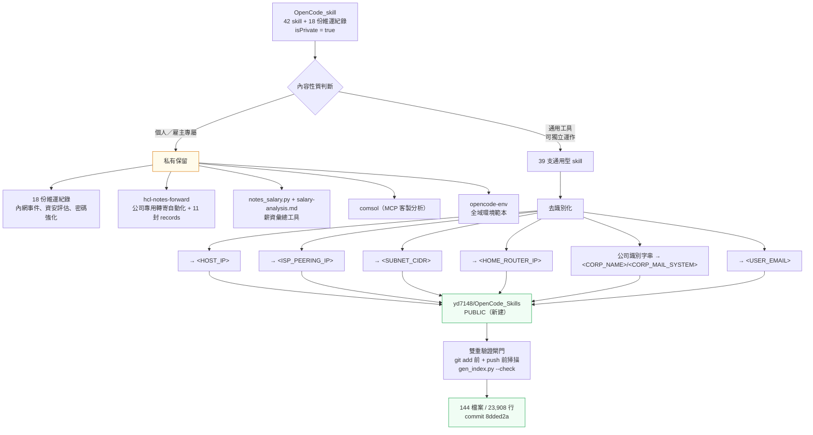
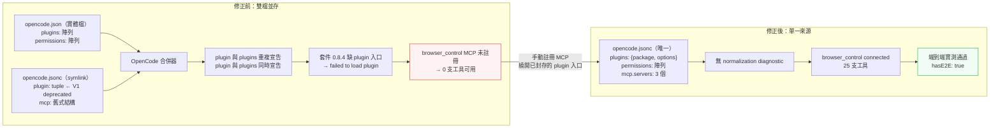
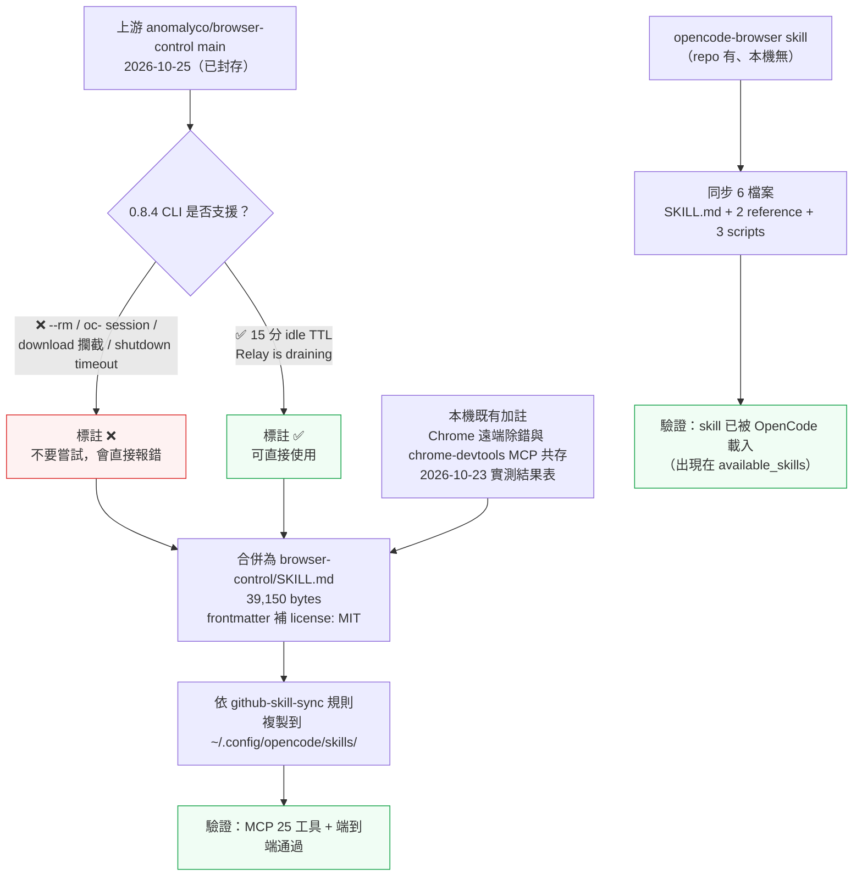

# Browser Skill 設定修正、Skill 同步與公開化評估

日期：2026-11-11
執行環境：Windows 11（`win32`）／OpenCode v2.0.16／Node v22.23.4／Chrome + Edge
適用範圍：`~/.config/opencode/` 全域環境、`yd7148/OpenCode_skill`（私有）、`yd7148/OpenCode_Skills`（新建公開）

---

## 1. 問題描述

使用者指示（保留原樣）：

> 請"直接套用 1、2 兩項設定修正"
> 再進行"3.🟡 同步 opencode-browser skill 到本機 + 更新 SKILL.md 至上游 main 版（多出 --rm、15 分 idle TTL、waitForEvent("download") 等）"
> 然後驗證一次
> 更新畚箕SKILL與PUSH 到GITHUB
> 另外評估"https://github.com/yd7148/OpenCode_skill"公開
> 但不能暴露機敏資訊
> 有需要就重整資料後，再另開一個公開REPO。
> 請詳細分析，使用MARKDWON、MERMAID與SVG格式說明與記錄下來。

承接前一輪（`browser-skill-comparison-20261111.md`）的分析結論，本輪實際執行：

| # | 前輪建議 | 本輪狀態 |
|---|---------|---------|
| 1 | 手動註冊 `browser_control` MCP | ✅ 已套用並驗證 |
| 2 | 合併 `opencode.json` 與 `opencode.jsonc` | ✅ 已套用並驗證 |
| 3 | 同步 `opencode-browser` skill + 更新 SKILL.md 至上游 main | ✅ 已套用（含版本相容性標註） |
| 7 | 同步 `opencode-browser` skill 到本機 | ✅ 已同步 |
| 9 | 公開性評估 → 另開公開 repo | ✅ 已建立 `yd7148/OpenCode_Skills` |

---

## 2. 診斷過程與證據

### 2.1 關鍵發現：本機有「兩個 clone」且全域設定指向舊的那個

全域設定的 symlink 鏈如下（實測 `Get-Item -Force` 的 `LinkType` / `Target`）：

```text
~/.config/opencode/opencode.jsonc
  → C:\Users\<USERPROFILE>\OpenCode_skill\opencode-env\opencode.jsonc   ← 舊 clone
D:\80-Opnecode\.opencode\opencode.jsonc
  → C:\Users\<USERPROFILE>\.config\opencode\opencode.jsonc              ← 再轉一次
```

| 位置 | 角色 | 檢查時 HEAD |
|------|------|------------|
| `D:\80-Opnecode\Projects\OpenCode_skill` | 本輪工作目錄 | `5a68a6e` |
| `C:\Users\<USERPROFILE>\OpenCode_skill` | **全域設定 symlink 的實際目標** | `da06e8a`（落後 3 個 commit，且 `opencode-env/opencode.jsonc` 有未提交變更） |

> **影響**：若只改工作目錄，全域設定不會變動。本輪先 `git stash` → `git merge --ff-only` 快轉舊 clone 到 `5a68a6e` → `git stash pop` 還原其未提交的 `chrome-devtools` MCP 變更，再把合併後的設定同步回兩邊。

### 2.2 設定檔的雙載入與 key 衝突

`opencode debug config` 顯示本機有 **5 份** 設定文件同時被載入：

```
C:\Users\<USERPROFILE>\.config\opencode\opencode.json      ← 實體檔，V2 "plugins"
C:\Users\<USERPROFILE>\.config\opencode\opencode.jsonc     ← symlink，V1 "plugin"
C:\Users\<USERPROFILE>\.config\opencode                     ← 目錄
D:\80-Opnecode\opencode.json                                ← 專案層，model
D:\80-Opnecode\.opencode\opencode.jsonc                     ← symlink → 全域 jsonc
```

V2 schema 對兩個 key 的定義（實測 `https://opencode.ai/config.json`）：

| key | schema 定義 | deprecated |
|-----|-------------|-----------|
| `plugin` | `type: array`，item 為 string 或 `[string, object]` tuple | **是** |
| `plugins` | `type: array`，item 為 string 或 `Config.Plugin.EntryEncoded`（`{package, options?}`） | 否 |

→ 兩檔並存造成 `plugin`（V1 舊欄位）與 `plugins`（V2 正解）同時宣告同一個 plugin，**重複載入**。

### 2.3 plugin 載入失敗的真正根因（不是設定寫錯）

```
level=WARN message="failed to load plugin" target=@opencode-ai/browser-control
cause="Cause([Fail(PluginModule.LoadError: Plugin must export a default definition
with an id and an effect or setup function)])"
```

| 驗證點 | 結果 | 判定 |
|--------|------|------|
| `opencode plugin list` | 列出 plugin 名稱，但 VERSION / SOURCE 皆為 `-` | 名單有，實際未載入 |
| npm 套件 `dist/index.js` | 有 `export { … as BrowserControlClient, … as SecretProfile }`；**無** `export default`、無 `id: "browser-control"`、無 `setup(ctx`、無 `skillDefinition` | ❌ 缺 plugin 入口 |
| 上游 `src/opencode.ts`（main） | 有 `export default { id: "browser-control", async setup(ctx) {…} }` | ✅ 上游有 |
| 上游 `.changeset/opencode-plugin.md` | `"@opencode-ai/browser-control": minor` — **尚未發布** | ⏳ 未發布 |
| npm `latest` | `0.8.4`（2026-10-06）；main 最後 commit 2026-10-25 | 套件比 main 舊 |
| GitHub repo | `archived: true`（2026-11-07 封存，read-only） | ⚠️ 不會再發布 |
| `search({namespace:"browser-control"})` | 回傳 **0** 個工具 | ❌ MCP 未註冊 |

**結論**：npm 上最後一版（0.8.4）根本不含 plugin 入口，且上游已封存 → **此路已死**，
只能改用 `mcp.servers` 手動註冊。

### 2.4 修復方案驗證（在暫存專案實測）

```jsonc
{
  "$schema": "https://opencode.ai/config.json",
  "mcp": {
    "browser_control": {
      "type": "local",
      "command": ["browser-control-mcp"]
    }
  }
}
```

`opencode mcp list` 實測輸出：

```
??browser_control    connected
??chrome-devtools    connected
??open-computer-use  connected
??opencode_console   needs authentication
```

> **踩坑**：`mcp.servers.<name>` 走 `Mcp.LocalConfigEncoded` schema（`additionalProperties: false`），
> **不接受 `enabled` 欄位**。第一次寫成 `"enabled": true` 時 `opencode mcp list` 顯示
> 「No MCP servers configured」；移除 `enabled` 後才連線。要停用得用 `disabled: true`。

### 2.5 SKILL.md：上游 main 比本機套件新（不可直接貼）

上游 `main`（2026-10-25）比已發布的 npm 0.8.4（2026-10-06）多出 19 天、10 餘個 commit。
逐項實測 0.8.4 CLI 是否支援上游文件提到的功能：

| 上游文件提到的功能 | 0.8.4 實測 | 證據 |
|-------------------|------------|------|
| `execute --rm` | ❌ 不存在 | `Unrecognized flag: --rm in command browser-control execute` |
| 裸 execute 沿用 `oc-$OPENCODE_SESSION_ID` | ❌ 不存在 | `grep OPENCODE_SESSION_ID dist/cli.js` → `False` |
| `waitForEvent("download")` 攔截 | ❌ 不存在 | `grep suggestedFilename / Content-Disposition dist/cli.js` → `False` |
| `BROWSER_CONTROL_SHUTDOWN_TIMEOUT_MS` | ❌ 不存在 | 同上 → `False` |
| 擴充功能 shim 0.0.26 | ❌ 本機為 0.0.25 | `browser-control status` → `Extension: connected (0.0.25)` |
| 15 分鐘 idle TTL | ✅ 已支援 | `grep "900000" dist/cli.js` → `True` |
| `Relay is draining` 診斷 | ✅ 已支援 | `grep "is draining" dist/cli.js` → `True` |

> **若直接貼上游 SKILL.md**，agent 會被教導使用本機不存在的旗標，指令會直接報錯，
> 且 skill 的「功能可用性」判斷全部失準。故本輪採**上游 main 為內容基準 + 逐項標註相容性**。

### 2.6 MCP `skill` 工具讀的是 npm 套件內附版，不是本機 skill 檔

同步後對照兩個來源，發現 MCP 工具與本機 skill 檔是**兩份不同的內容**：

| 來源 | 大小 | 含〈本機版本相容性〉表 |
|------|------|---------------------|
| `~/.config/opencode/skills/browser-control/SKILL.md`（本機，已同步） | 39,150 bytes | ✅ 有 |
| npm 套件 `skills/browser-control/SKILL.md`（MCP `skill` 工具讀這份） | 32,855 bytes | ❌ 無 |

原因（讀 `dist/mcp.js` 原始碼確認）：

```js
var packageRoot = path2.dirname(path2.dirname(fileURLToPath2(import.meta.url)));
// ...
fs.readFile(path2.join(packageRoot, "skills", "browser-control", "SKILL.md"), "utf8")
```

MCP 的 `skill` 工具以**套件安裝目錄**推導路徑，與 `~/.config/opencode/skills/` 無關。
實測 `browser_control.skill()` 回傳 33,649 bytes，內容為 0.8.4 原始版（無相容性表）。

**影響與處置**：
- agent 若走「載入 skill 檔」路徑 → 拿到 39,150 bytes 的**含相容性表**版本 ✅
- agent 若走「呼叫 MCP `skill()` 工具」路徑 → 拿到 32,855 bytes 的**無相容性表**版本 ⚠️

因此相容性標註**必須**以 skill 檔為準，MCP `skill()` 僅作為上游原始文件參考。
本 repo 的 `browser-control/SKILL.md` 是唯一真實來源（本機同步自此處），已含相容性表。

### 2.7 額外發現（既有問題，非本輪變更造成）

`opencode-auto-name` v0.1.3 **自 2026-10-05 起從未在 V2 載入成功**：

| 項目 | 實測值 |
|------|--------|
| 首次失敗 | `2026-10-05T02:15:38Z`（早於本輪 11-11 一個月） |
| 總失敗次數 | **2386** |
| 成功載入次數 | **0** |
| 失敗原因 | `SchemaError(Expected object at ["default"])` |

根因：該套件的 `dist/index.js` 是 `export default function sessionNamePlugin(opts) {…}`
—— **V1 格式（匯出函式）**；V2 要求 `Plugin.define({ id, setup(ctx) })` 物件。
npm 上僅有 `0.1.0 / 0.1.1 / 0.1.3` 三版，最新 0.1.3 仍依賴 `@opencode-ai/plugin ^1.18.10`（V1），
**沒有 V2 相容版本**。

→ 本輪**不修**（超出本次範圍，且需移植整個 plugin），僅在報告中記錄並在設定中
改用 V2 正確的 `{ package, options }` 格式，確保**未來**換成 V2 版本即可直接生效。

---

## 3. 處理動作與實測結果

### 3.1 全域設定合併

最終 `~/.config/opencode/opencode.jsonc` 結構（單一來源）：

| 區塊 | 內容 | 修正重點 |
|------|------|---------|
| `plugins` | `[{ package: "opencode-auto-name", options: { template, maxLength } }]` | V2 物件格式；移除失效的 `@opencode-ai/browser-control` |
| `permissions` | 5 條 `{action, resource, effect}` 陣列 | 符合 `Permission.Ruleset`（原本物件式會被判定 malformed） |
| `mcp.servers` | `browser_control` / `open-computer-use` / `chrome-devtools` | 統一改用 `mcp.servers` 結構 |

`~/.config/opencode/opencode.json` 已改名為 `opencode.json.disabled`（備份於
`~/.config/opencode/backup_20261111_095559/`），消除雙檔並存的 key 衝突。

### 3.2 Skill 同步

| Skill | 同步前 | 同步後 |
|-------|--------|--------|
| `browser-control/SKILL.md` | 32,866 bytes（npm 0.8.4 版 + 舊加註） | **39,150 bytes**（上游 main + 版本相容性表 + 本機加註） |
| `opencode-browser/` | **不存在** | **6 檔案**（SKILL.md + 2 reference + 3 scripts） |

同步依 `github-skill-sync` skill 的規則：從 `~/OpenCode_skill` clone 複製到
`~/.config/opencode/skills/`，排除 `comsol*` / `hcl-*` / `.venv` / `__pycache__`。

### 3.3 驗證（一次完整驗證）

| 驗證項 | 指令／方式 | 結果 |
|--------|-----------|------|
| MCP 註冊 | `opencode mcp list` | `browser_control connected`／`chrome-devtools connected`／`open-computer-use connected` |
| MCP 工具數 | `search({namespace:"browser_control"})` | **25 支**（execute / session_* / network_* / recording_* / flight_recorder_* / secrets_* / skill / status） |
| MCP 實呼叫 | `browser_control.status()` | `connected: true`、`version: "0.0.25"`、`protocolCompatible: true` |
| **端到端** | `browser_control.execute({ code: 'await page.goto("http://127.0.0.1:38122/"); …' })` | `ok: true`、`hasE2E: true`、`hasButton: true`、`navigations: ["http://127.0.0.1:38122/"]`、`consoleErrorCount: 0` |
| 設定警告 | `server log` 檢查 `normalization diagnostic` | **0**（原為每 session 數筆） |
| plugin 失敗 | `server log` 檢查 `failed to load plugin` | **0**（browser-control 部分；auto-name 為既有問題） |
| 索引一致 | `py scripts/gen_index.py --check` | `OK: 42 個 skill，索引與內容一致` |
| 清理 | 測試 session / 暫存 server | 已 `session delete`、已 kill、暫存檔已刪 |

### 3.4 Git 推送

| Repo | 動作 | Commit |
|------|------|--------|
| `yd7148/OpenCode_skill`（私有） | `browser-control/SKILL.md` 併入上游 main + 相容性標註 | `b2538fb` |
| `yd7148/OpenCode_skill`（私有） | 合併全域設定 + 修正 V2 欄位 + `.gitignore` 排除 `.codex/` | `557a839` |
| `yd7148/OpenCode_Skills`（新建公開） | 初始提交 144 檔案 | `8dded2a` |

兩個 clone 皆已同步到 `557a839`，`local HEAD == origin/main` 實測相符。

---

## 4. 公開化評估

### 4.1 現況

`gh repo view yd7148/OpenCode_skill --json visibility,isPrivate` 實測：

```json
{"defaultBranchRef":{"name":"main"},"description":"tested_skill","isFork":false,
 "isPrivate":true,"name":"OpenCode_skill","visibility":"PRIVATE"}
```

→ **現行 repo 本來就是 PRIVATE**，不是「已公開待清理」。評估問題因此是：
*「要公開的話，需要拆成哪些內容？哪些必須留在私有？」*

### 4.2 全 repo 敏感資訊掃描結果

| 類別 | 掃描樣式 | 命中 | 位置與性質 |
|------|---------|------|-----------|
| 內網主機 IP | `<HOST_IP>` 等 RFC1918 位址 | 8 處 | `network-port-check/reference/sample-report.md`（本機 IP、gateway、內部 DNS）、`interpretation.md`、`mac-acceleration.md` |
| ISP peering IP | 對等連線（ISP peering）位址 | 9 處 | 同上 |
| 內網網段 | `<SUBNET_CIDR>` | 1 處 | `network-remediation-options-20260930.md` |
| 家用路由器 | `<HOME_ROUTER_IP>` | 1 處 | `network-warp-clash-assessment-20260930.md` |
| **個人薪資數值** | `--bonus-income` 的六位數金額參數 | 3 處 | `hcl-notes-forward/reference/salary-analysis.md`、`scripts/notes_salary.py` |
| 公司識別字串 | `<CORP_NAME>` / `<CORP_DOMAIN_SHORT>` / `<CORP_MAIL_SYSTEM>` | 30+ 處 | 多個 skill 的說明文字 |
| 個人 Email | `<USER_EMAIL>` | 3 處 | `github-skill-sync/SKILL.md`、`cv-job-application/SKILL.md` |
| 代理憑證 | `http://user:****@<PROXY_IP>:80` | — | ✅ **已遮蔽**（根目錄 18 份紀錄皆已用佔位符） |
| 主機名稱 | `DESKTOP-XXXX` | 0 | ✅ 無真實主機名 |
| 憑證 / token | `gh[pousr]_*` / `sk-*` / PRIVATE KEY | 0 | ✅ 無 |
| 員工代號 | `<EMP_ID>` 等佔位符關鍵字 | 0 | ✅ 僅為佔位符說明文字 |
| 身分證字號 | — | 0 | ✅ 無 |

### 4.3 分流決策



**決策表**：

| 內容 | 處置 | 理由 |
|------|------|------|
| 39 支通用型 skill | ✅ 公開（去識別後） | 工具型／流程型／參考資料型，可獨立運作，無雇主或個人依賴 |
| `hcl-notes-forward` | ❌ 整支排除 | SKILL.md 87 KB 全篇為該公司 Notes 系統的專用作業細節（UIA 座標、OCR 流程、資料庫配額事件）；26 支 script 全為其專用自動化。去除識別字串後功能已毀，且無公開價值 |
| `hcl-notes-forward/records/` | ❌ 排除 | 11 封實際公佈函轉寄紀錄，含內部流程與郵件內容摘要 |
| `notes_salary.py` + `salary-analysis.md` | ❌ 排除 | 薪資彙總工具，示範參數含個人薪資數值 |
| `comsol` | ❌ 排除 | 第三方軟體客製分析；`github-skill-sync` 本就列為「刻意不安裝」 |
| `opencode-env/` | ❌ 排除 | 全域環境範本，含機器專屬設定與 `LOCAL-ENVIRONMENT.md` |
| 18 份根目錄維運紀錄 | ❌ 排除 | 含公司網路事件、資安評估、密碼強化 → 屬雇主資產 |

### 4.4 公開 repo 最終驗證

| 閘門 | 結果 |
|------|------|
| `git add` 前全文掃描（17 組樣式） | **0 命中** |
| `git diff --cached` 決定性掃描 | **PASS：無敏感資訊** |
| `py scripts/gen_index.py --check` | exit 0，索引與內容一致 |
| 線上 README 回讀（GitHub API） | 18,753 bytes，〈公開版說明〉區塊正確呈現 |
| 遠端 HEAD == 本機 HEAD | `8dded2a` == `8dded2a` |
| repo 可見性 | `visibility: PUBLIC` |

---

## 5. 視覺化圖表

### 5.1 Mermaid：設定修正前後



### 5.2 Mermaid：Skill 同步與版本分級



### 5.3 SVG 圖

| 圖檔 | 說明 |
|------|------|
| [`assets/config-merge.svg`](assets/config-merge.svg) | 全域設定合併前後對照（含實測驗證與既有問題標註） |
| [`assets/skill-version-gap.svg`](assets/skill-version-gap.svg) | 上游 main 與本機 0.8.4 的功能落差與分級處置 |
| [`assets/repo-compare.svg`](assets/repo-compare.svg) | 三個 Browser Skill Repo 方案比較（本機實測） |
| [`assets/repo-split.svg`](assets/repo-split.svg) | 公開化分流：私有保留 vs 公開釋出與驗證閘門 |

---

## 6. 改善對策

### 6.1 立即層（本輪已完成）

- [x] 合併全域設定為單一 `opencode.jsonc`，改用 V2 欄位（`plugins` / `mcp.servers` / 陣列式 `permissions`）
- [x] 手動註冊 `browser_control` MCP，恢復 25 支工具
- [x] `browser-control/SKILL.md` 併入上游 main + 版本相容性標註
- [x] `opencode-browser` skill 同步到本機
- [x] 兩個 clone 同步到 `557a839`，全域 symlink 目標與工作目錄一致
- [x] 建立公開 repo `yd7148/OpenCode_Skills`（39 skills，去識別）

### 6.2 短期層（待辦）

| # | 事項 | 責任層 | 說明 |
|---|------|--------|------|
| 1 | 移植 `opencode-auto-name` 至 V2 plugin 格式 | 本機 | 目前已失效 2386 次且從未成功；需改寫為 `Plugin.define({id, setup(ctx)})` + `ctx.session.hook("title", …)`。本 repo 的 `opencode-session-auto-name` skill 可作為規格 |
| 2 | 統一兩個 clone 的使用慣例 | 本機 | 目前工作目錄是 `D:\80-Opnecode\Projects\OpenCode_skill`，但 `github-skill-sync` skill 與全域 symlink 都指向 `C:\Users\<USERPROFILE>\OpenCode_skill`。建議二選一或明確分工 |
| 3 | `browser-control` 套件監看 | 本機 | 上游已封存 → 不會有新版本。0.8.4 將是最終版；若需 `--rm` 等功能只能自行 patch |
| 4 | `network-port-check` 去識別化 | 本機 | 私有 repo 內仍含真實內網 IP，若日後要公開需先遮蔽 |

### 6.3 中期層

| # | 事項 | 說明 |
|---|------|------|
| 1 | 評估安裝 Tencent BrowserSkill | 僅在需要「網站除錯 evidence／表格抽取／反注入規範／遠端配對」時；Chrome Web Store 被擋，須走 Edge Add-ons |
| 2 | 公開 repo 的 README 加「原始 repo」交叉連結 | 已於〈公開版說明〉加入指向 `yd7148/OpenCode_skill` 的連結 |
| 3 | 建立發布前自動掃描 | 將本輪的 17 組掃描樣式固化成 CI 步驟，避免未來新增 skill 時誤踩 |

---

## 7. 踩過的坑

| 坑 | 症狀 | 解法 |
|---|---|---|
| `.ps1` 內含中文卻無 UTF-8 BOM | `ParserError` 指向無關行號（`String missing terminator`） | 寫入後確認前三 bytes 為 `EF BB BF`（AGENTS.md 第四章已記載，本輪再次實測） |
| `mcp.servers` 加 `enabled: true` | `opencode mcp list` 顯示「No MCP servers configured」 | `Mcp.LocalConfigEncoded` 不接受該欄位，移除即可；要停用用 `disabled: true` |
| `plugins` 用 V1 tuple 格式 | log：`path=$.plugins.0 kind=invalid action="skipped malformed recognized value"` | 改用 V2 物件格式 `{ package, options }` |
| `permissions` 用物件格式 | log：`path=$.permissions kind=invalid` | V2 `Permission.Ruleset` 是陣列，改用 `[{action, resource, effect}]` |
| 只改工作目錄，全域設定沒變 | 全域 symlink 指向另一個 clone | 先 `git merge --ff-only` 快轉舊 clone，再同步兩邊 |
| `git merge --ff-only` 被未提交變更阻擋 | `Please commit your changes or stash them before you merge` | `git stash` → merge → `git stash pop` |
| 直接貼上游 SKILL.md | agent 會用到不存在的旗標 | 上游 main 比 npm 套件新（repo 已封存不再發布）→ 逐項實測並加相容性表 |
| 正則 `.*?` + 行首 code fence 收尾 | 跨過下一個 `##` 標題，誤刪後續章節 | 改以「下一個 `^## ` 標題」為界 |
| JS regex 用 `$` 配 `m` flag | 只刪到行尾而非字串結尾 | 用 `\z` 表示字串結尾 |
| `powershell.exe` 讀 UTF-8 BOM 腳本 | 中文常數被判斷錯誤、章節沒被刪掉 | 改用 Node.js 處理 UTF-8 文字檔 |
| `gh repo create --no-gitignore` | `unknown flag` | 該旗標不存在，直接建立後自行 `.gitignore` |

---

## 8. 附錄：關鍵實測指令

```powershell
# 設定檔拓撲與 symlink 目標
Get-Item "$env:USERPROFILE\.config\opencode\opencode.jsonc" -Force |
  Select-Object Name, Attributes, LinkType, Target

# 哪些設定文件被載入
opencode debug config | Select-String '"path"'

# plugin 載入失敗
Select-String -Path "$env:USERPROFILE\.local\share\opencode\log\opencode.log" `
  -Pattern "failed to load plugin" | Select-Object -Last 5

# 套件是否含 plugin 入口
Select-String -Path "$env:APPDATA\npm\node_modules\@opencode-ai\browser-control\dist\index.js" `
  -Pattern "export default","skillDefinition","setup\(ctx"

# 0.8.4 功能可用性
browser-control execute --rm 'return 1'          # Unrecognized flag: --rm
Select-String -Path "$env:APPDATA\npm\node_modules\@opencode-ai\browser-control\dist\cli.js" `
  -Pattern "OPENCODE_SESSION_ID","suggestedFilename","900000","is draining"

# MCP 註冊與實呼叫
opencode mcp list
browser-control-mcp   # tools/list → 27 支

# 索引一致性
py scripts/gen_index.py --check

# 公開 repo 安全閘門
git show HEAD | Select-String -Pattern '<內網IP>|<員工代號>|<主機名稱>|<組織網域>|<憑證>'
```
