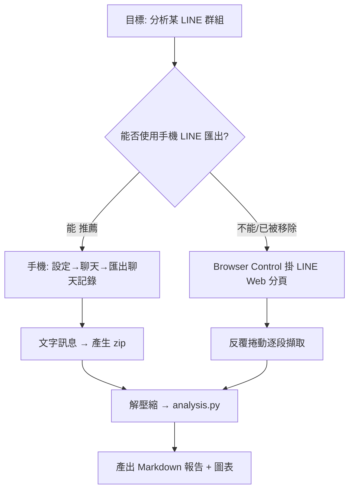
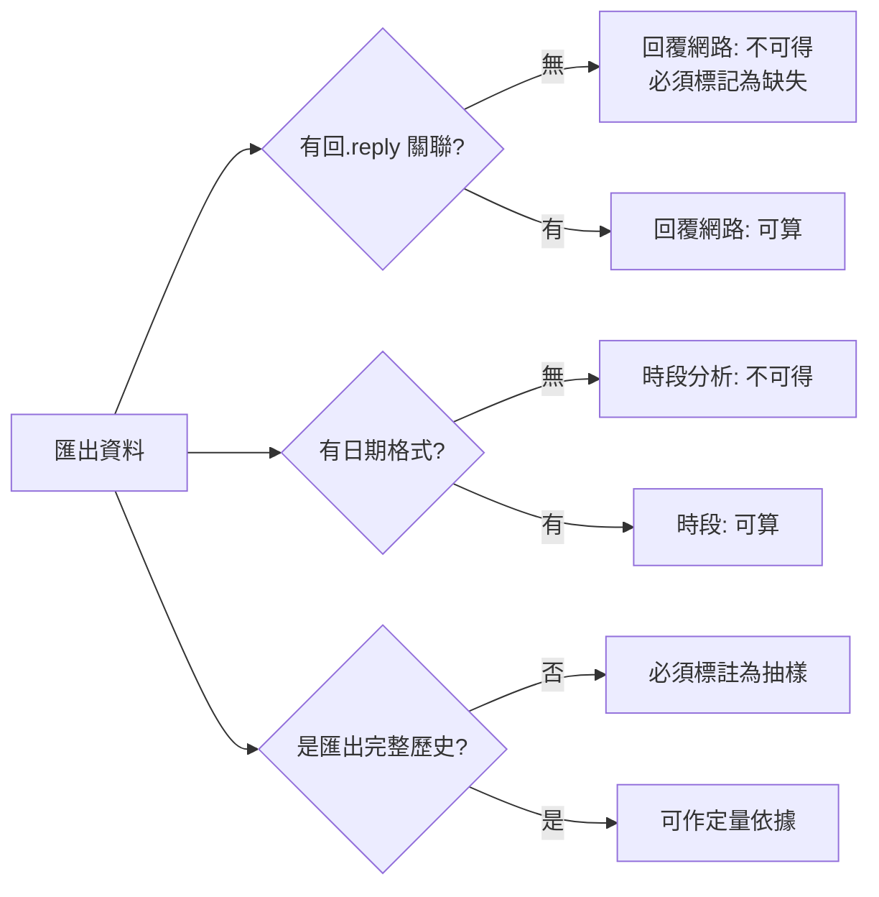

# LINE 群組聊天記錄匯出與分析

兩條取得資料的路徑，優先順序如下。



---

## 路線 A：手機匯出（推薦，完整且快速）

1. 手機 LINE → **設定** → **聊天** → **匯出聊天記錄**
2. 選群組 → 格式勾「**文字訊息**」（+ 貼圖可選，會影響檔案大小）
3. **日期格式**選含年月日時（`YYYY/MM/DD(週X)`）— 這決定解析器能否算時段
4. 產生 zip → 傳到電腦

### 產出結構

```text
<匯出資料夾>/
  <群組名稱>/
    2025-06-01.txt
    2025-07-01.txt
    ...
  _common/
    群組基本資料.txt      # 含群組名稱
    匯出說明.txt
```

訊息列格式（文字訊息）：

```text
2025/06/01(週日)
13:24	劉士禎	大家早
13:25	王小明	早安～今天天氣不錯
```

> **刪除的訊息**會是 `某某某 已刪除了一則訊息`；**貼圖/貼圖梗圖**只有時間戳沒文字；
> **回覆**在文字匯出中不會保留被回覆的原文，只有時間與寄件者。

---

## 路線 B：Browser Control 掛 LINE Web 分頁

僅在無法匯出時使用。**必要前提：使用者必須在 Chrome 的 LINE 分頁上主動點工具列的 Browser Control 按鈕**，擴充功能才會 attach；未 attach 的分頁永遠出現在 targets 清單外。

```powershell
# 0. 確認 relay 與擴充功能已連線（第一次會自動啟動 relay）
browser-control status --json

# 1. 掛上使用者已登入的分頁
browser-control session adopt --target-url chat.line.com --session line-grp

# 2. 讀取目前可見訊息
browser-control execute --session line-grp --json 'return await snapshot({ find: /message|訊息/, maxItems: 60 })'
```

### 虛擬滾動的限制（必讀）

| 限制 | 後果 |
|---|---|
| DOM 只保留畫面上可見的約 30–50 則訊息 | 單次擷取必然不完整 |
| 往上捲才載入更早內容 | 需要反覆 `mouse.wheel(0, -N)` 後再擷取 |
| 捲動過快觸發 Rate Limit | 必須固定延遲（建議 800–1500 ms）逐段捲 |
| 一般聊天記錄不會全部下載給你 | 能爬到多少取決於該群組歷史長度與權限 |
| 圖片／貼圖只有佔位元素 | 需另外處理 media placeholder |

因此**路線 B 只能得到近似樣本，不是完整歷史**。若分析結果要作為定量依據，改用路線 A。

### 逐段捲動擷取骨架

在 session 內累積到 Node 端的 `state`，避免把整份歷史塞進單次回傳：

```js
// 建議分多次 execute 呼叫，每次捲一段，中途把 state 落地成檔
state.msgs = state.msgs || [];
const read = async () => {
  const items = await page.$$eval(
    '[data-testid="message-list"] li, div[data-testid="msgItem"]',
    (els) => els.map((e) => e.innerText.trim()).filter(Boolean)
  );
  state.msgs.push(...items);
};
await read();
await page.mouse.wheel(0, -800);
await page.waitForTimeout(1200);
await read();
return { collected: state.msgs.length };
```

> ⚠️ **selector 必須先 inspect 確認**，不可照抄。LINE Web 的 DOM 結構會改版，且會出現多個同名 class。先用
> `return await snapshot()` 或 `page.$$eval` 探測再固定下來。

---

## 分析腳本

```bash
# --input 必須指向「群組資料夾本身」（含 YYYY-MM-DD.txt 的那一層），不是匯出根目錄。
# 腳本用 os.listdir() 非遞迴，傳根目錄會報「找不到 .txt 或資料夾」。
# 同理，路徑含中文時 shell 傳參會被 CP950 破壞 → 請用純 ASCII 的暫存路徑。
python scripts/analyze_line.py --input "<群組資料夾>" --out ./output
```

輸出一份 Markdown 報告 + `summary.json` + `daily.csv`。

### 指標定義

| 指標 | 定義 | 備註 |
|---|---|---|
| 總發文數 | 逐列解析後的成功解析訊息數 | 刪除訊息、貼圖單獨計類 |
| 發文頻率 | 人均每日訊息數 = 該員總數 / 該員有發文的日數 | 另列「總天數（含沉默）」避免誤解 |
| 活躍時段 | 以小時為單位分佈 0–23 | 文字匯出需含日期格式才可靠 |
| 平均訊息長度 | 字元數中位數（不用平均，抗長文偏誤） | 同時列 P90 |
| 回覆網路 | 有 `回覆` 標記才計；文字匯出**拿不到** | 路線 B 可從 DOM 的 reply 元素取 |
| 話題分布 | 依關鍵詞／emoji／貼圖統計 | 詞表寫死在 `scripts/analyze_line.py` 的 `TOPIC_KEYWORDS` |
| 立場光譜 | 群組**整體**的議題分布 | **不是**對個人下判斷 |

### 邊界與必須誠實聲明的事



報告中下列四點**必須顯式寫出**，不可省略：

1. **資料完整性**：是匯出檔（完整）還是捲動抽樣（近似）。抽樣時寫明取得比例與期間。
2. **缺失指標**：路線 A 拿不到回覆關聯、看不到貼圖內容、看不到已編輯/已刪除原文。
3. **觀察 vs 推測**：統計結果是觀察；動機、情緒、成因為推測，兩者必須分欄。
4. **不做的分析**：本 skill **不對特定個人做政治傾向、意識形態、性取向、醫療等敏感屬性判定**。可做的是群組整體的議題與立場分布。

---

## 常見坑

| 坑 | 症狀 | 解法 |
|---|---|---|
| **Big5/UTF-8 混雜** | 讀出中文亂碼或部分月檔正常 | 用 `encoding` 自動偵測 + `utf-8-sig`，別硬寫死 |
| **全形冒號** | `發文者：內容` 而非 Tab 分隔 | regex 同時接受 `\t` 與 `：／:` |
| **Excel 另存的 tab 檔** | 整個檔案被當成一個 cell | 強制 `encoding` 且不要用 `read_csv` 預設 |
| **貼圖列** | 沒有發文者欄位，解析錯位 | 單獨 branch 判斷「本列是否含時間戳」 |
| **刪除訊息列** | 發文者欄位是「某某某」 | 視為有效訊息但標記 `deleted` |
| **捲動太快被限流** | 突然只載入舊資料或出現錯誤 | 每次捲動固定 `waitForTimeout(1200)` |
| **relay 未啟動** | `session adopt` 報 RelayRejected | 先跑一次 `execute --json` 會自動啟動 relay |
| **分頁沒被 attach** | adopt 報 `No existing attached page URL includes...` | 要使用者**手動點工具列按鈕**，無法用指令代替 |
| **假分頁** | targets 有 `about:blank` | 那是 session 自建頁，不是使用者分頁，別誤認 |

---

## 附錄

- 敏感資訊：聊天記錄含他人個資，**不可** commit 到公開 repo。輸出先放本機暫存目錄並確認過敏內容再決定去向。
- 路線 B 若 `chat.line.com` 被網路政策封鎖（`ERR_TUNNEL_CONNECTION_FAILED` / curl 回 `000`），adopt 會失敗 —— 需走正式網域放行申請，**不做技術性繞過**。