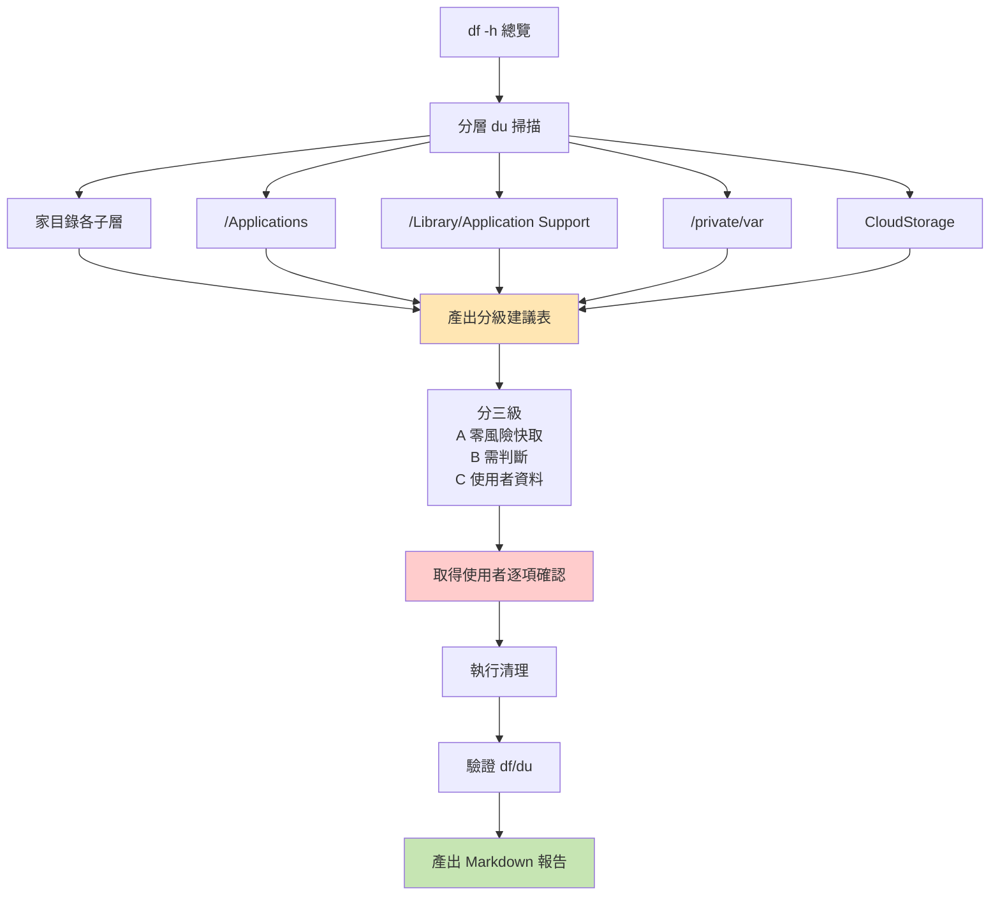
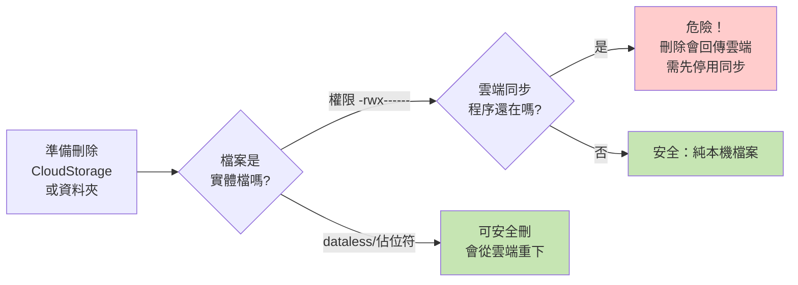
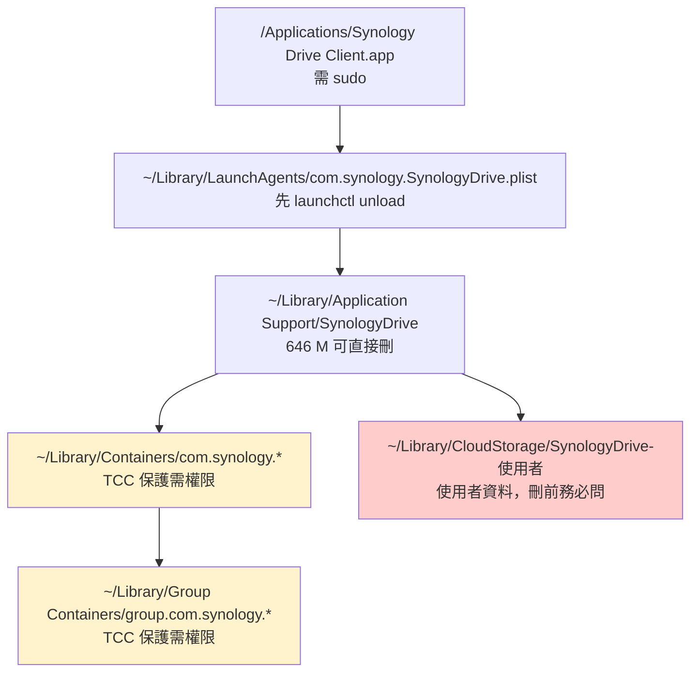

# mac-disk-cleanup — macOS 磁碟空間掃描與清理

盤點 macOS 磁碟用量、辨識可回收空間、執行安全清理與應用程式移除，產出繁中報告。

**核心原則：先掃描、後提案、再執行。絕不擅自刪除使用者資料。**

## 執行流程



## 第一步：總覽

```bash
df -h /System/Volumes/Data /
```

macOS Catalina 起 APFS 分成多個卷，**真實可用空間看 `/System/Volumes/Data`**，不要看 `/`（它只顯示唯讀系統卷）。

注意快照（Time Machine）會讓 `df` 顯示的數字偏大，`du` 遍歷整個系統也會被快照卡住。

## 第二步：分層掃描

**掃描前務必殺掉所有 Finder 視窗**（`killall Finder`），否則 CloudStorage 會大量報 `Resource deadlock avoided` 而掃不動。

依序執行：

```bash
# 家目錄頂層
du -sh ~/Library ~/Downloads ~/Pictures ~/Documents ~/Desktop ~/Movies ~/.cache 2>/dev/null | sort -rh

# 使用者 Library（最容易藏大魚）
du -sh ~/Library/* 2>/dev/null | sort -rh | head -15
du -sh ~/Library/"Application Support"/* 2>/dev/null | sort -rh | head -15
du -sh ~/Library/Caches/* 2>/dev/null | sort -rh | head -15

# 系統層（**重點：Adobe 素材常在這裡**）
du -sh "/Library/Application Support"/* 2>/dev/null | sort -rh | head -15
du -sh /Library/* 2>/dev/null | sort -rh | head -12

# /private/var（swap、db、暫存）
du -sh /private/var/* 2>/dev/null | sort -rh | head -8

# /Applications
du -sh /Applications/* 2>/dev/null | sort -rh | head -25
```

`sort -rh` 的 `h` = human readable，是這套流程的關鍵。

### 常見隱藏大戶（本機實測）

| 路徑 | 典型大小 | 說明 |
|---|---|---|
| `/Library/Application Support/Adobe/Premiere Pro/25.0/SpeechESL` | **13 G** | Premiere 語音轉字幕語言模型，**最大單一項**。不剪Premiere 影片可全刪 |
| `/Library/Application Support/Adobe/CameraRaw/ModelZoo` + `CameraProfiles` + `LensProfiles` | 2.2 G | AI 機型/鏡頭模擬設定，Lightroom 會重建 |
| `~/Library/Application Support/com.apple.wallpaper` | 2.0 G | 動態桌布影片 |
| `~/Library/Application Support/Zed`、`Antigravity`、`Comet` | 各 0.3–1.3 G | 少用編輯器的索引/快取 |
| `/private/var/vm` | 2.0 G | swap，不需手動處理 |
| `/private/var/db` | 2.9 G | 系統資料庫，**不要碰** |

## 第三步：分級提案

**絕對不要**把整份掃描結果丟給使用者，要分三級：

### A 級 — 零風險快取（可自動執行）
`~/Library/Caches/*`、`~/.cache/*`、`~/Library/Application Support/*/Cache`
重啟應用程式自動重建。約可回收 10 G+。

### B 級 — 需判斷
閒置應用程式、大體積語言模型、使用者明確說不用的資料夾。**每項都要問。**

### C 級 — 使用者資料（不可擅動）
`~/Downloads`、`~/Pictures`、Lightroom 圖庫、`~/Documents`、雲端同步資料夾。
**必須逐項列出內容，讓使用者自己判斷。**

## 關鍵安全守則



### 1. 刪雲端資料夾前必須驗證

`~/Library/CloudStorage/*` 是 FileProvider 掛載點，**直接 `rm -rf` 可能把刪除同步回雲端，永久刪掉雲端資料**。

```bash
# 看檔案權限：-rwx------ = 實體檔；帶 @ 且 dataless 才是佔位符
ls -la ~/Library/CloudStorage/目標資料夾/

# 確認同步程序是否還活著
ps aux | grep -iE "synology|onedrive" | grep -v grep
mount | grep -iE "onedrive|clouddocs"
```

- 實體檔 + 程序已停 → 刪除只影響本機
- 程序還在 → **先停用再刪**，否則刪除會回傳雲端

### 2. 權限錯誤的處理

| 錯誤訊息 | 原因 | 解法 |
|---|---|---|
| `Operation not permitted` | TCC 沙箱保護（容器／群組容器） | 系統設定 → 隱私權與安全性 → 完全檔案系統存取權限 → 加入終端機 → **重開終端機** |
| `Permission denied` | 檔案擁有者是 root 或有 ACL | `sudo rm -rf` |
| `Resource deadlock avoided` | Finder 正在存取該目錄 | `killall Finder` 後重試 |

**TCC 保護的容器刪不掉時，先量測大小**——若只是空 metadata 外殼（通常 32–44 KB），可告知使用者「無實體資料，可不處理」，不要糾結。

### 3. 優先移入廢紙簍

```bash
mv 目標資料夾 ~/.Trash/    # 30 天內可復原
```

移不進去（跨卷、CloudStorage 權限）才用 `rm -rf`。**刪除使用者資料前務必告知不可復原。**

### 4. 不要用 `rm -rf ~` 類危險模式

- 避免 `rm -rf ~/Library` 這種整層刪除
- 路徑有空格必須加引號：`"/Library/Application Support/Adobe"`
- zsh 的 `no matches found` 會讓整條指令中止，用 `ls -d` 搭配 glob 時要留意

## 移除雲端同步軟體

完整流程見 `reference/uninstall-cloud-sync.md`，涵蓋 Synology Drive Client 與 OneDrive 的完整移除清單。

Synology Drive 用戶層結構：



**順序很重要**：先 `launchctl unload` 再刪 plist，否則登入項目會殘留。

## 驗證

清理後務必重新量測並在報告中列出前後對比：

```bash
df -h /System/Volumes/Data
du -sh ~/Library/Caches ~/.cache ~/Library/CloudStorage /Applications
ps aux | grep -iE "synology|onedrive" | grep -v grep
ls -d /Applications/已刪除的App   # 應無輸出
```

## 產出報告

報告需包含：
1. 成果總覽表（清理前後 df 對比 + 各目錄變化）
2. Mermaid 流程圖（清理流程）
3. 逐項明細表（大戶分類、大小、處理方式）
4. **刪除的資料完整清單**（含所有子資料夾名稱）
5. 待處理事項（權限不足的、需手動的、建議但未執行的）
6. 驗證指令
7. 遺失風險提醒

存放位置建議 `~/Desktop/mac清理紀錄/清理報告-YYYYMMDD.md`。

## 速查

| 用途 | 指令 |
|---|---|
| 磁碟總覽 | `df -h /System/Volumes/Data` |
| 目錄大小排序 | `du -sh X/* \| sort -rh \| head -15` |
| Finder 卡住掃描 | `killall Finder` |
| 停用登入項目 | `launchctl unload ~/Library/LaunchAgents/X.plist` |
| 確認同步程序 | `ps aux \| grep -iE "synology\|onedrive"` |
| 找大型應用程式 | `du -sh /Applications/* \| sort -rh` |

## 注意事項

- `du` 掃整個磁碟會非常慢（分鐘級），耐心等或分層掃
- 不要對 `/private/var/db`、`/System`、`/private/var/vm` 做任何操作
- 遇到需要管理員密碼的步驟，**不要嘗試猜密碼**，直接產出指令讓使用者自己執行
- 使用者的 sudo 指令若已執行過（如 COMSOL 刪除後 `/Applications` 縮小），要記得驗證而非重複執行