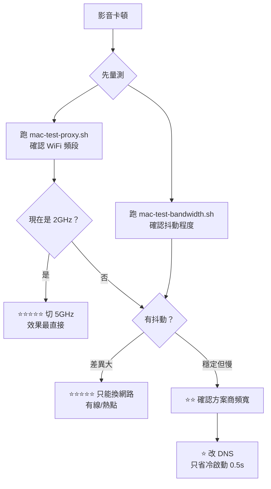

# network-port-check — 對外網路連線檢查

盤點本機**對外**（outbound）網路環境：哪些 TCP port 可連、哪些服務（尤其 RDP/SSH）
能否接通、哪些網站被擋、TLS 是否遭中間人破解、以及頻寬延遲。產出繁中 Markdown 報告。

**無需安裝任何套件** — Windows 用內建 PowerShell + `curl.exe`；macOS 用內建 bash + `curl`/`nc`/`dig`。

---

## ⚠️ 先判斷作業系統

| 平台 | 用哪套腳本 |
|------|-----------|
| **Windows** | `scripts\run-all.ps1`、`test-*.ps1`（本 skill 原始版本） |
| **macOS** | `scripts/mac-*.sh`（bash 版，2026-10 補上） |

> 兩套腳本檢查項目對齊，但實作方式完全不同。
> 在 macOS 上跑 `.ps1` 會直接失敗——請改用 `mac-` 前綴版本。

---

## macOS 快速開始

```bash
cd ~/.config/opencode/skills/network-port-check/scripts

# 一鍵跑完六項並產生 Markdown 報告
./mac-run-all.sh                      # 預設輸出到 ~/
./mac-run-all.sh /tmp/net.md          # 指定輸出路徑

# 只跑單項
./mac-test-proxy.sh                   # Proxy / VPN / DNS / WiFi 頻段 ← 最先用這個
./mac-test-bandwidth.sh               # 延遲 / DNS / IPv4v6 / 頻寬 / 抖動 / traceroute
./mac-test-ports.sh                   # port 矩陣（可帶參數）
./mac-test-websites.sh                # 網站可達性 + 真封鎖判定
./mac-test-tls.sh                     # TLS 憑證 / MITM 偵測

# 加速設定輔助（安全、可逆）
./mac-tune-network.sh 檢查            # 看目前設定與建議值
./mac-tune-network.sh 套用            # 備份並改成 8.8.8.8 + 168.95.1.1
./mac-tune-network.sh 還原            # 一鍵還原
```

```bash
# 自訂參數
./mac-test-ports.sh "443,22,3389" "www.google.com,github.com"
./mac-test-websites.sh ./sites.json   # [{"u":"https://..."}]
./mac-test-tls.sh "www.google.com,github.com"
```

---

## Windows 快速開始

```powershell
# 全部檢查 + 產生報告（一鍵）
powershell -NoProfile -ExecutionPolicy Bypass -File scripts\run-all.ps1

# 只跑單項
powershell -NoProfile -ExecutionPolicy Bypass -File scripts\test-ports.ps1
powershell -NoProfile -ExecutionPolicy Bypass -File scripts\test-services.ps1
powershell -NoProfile -ExecutionPolicy Bypass -File scripts\test-websites.ps1
powershell -NoProfile -ExecutionPolicy Bypass -File scripts\test-tls.ps1
powershell -NoProfile -ExecutionPolicy Bypass -File scripts\test-bandwidth.ps1

# 單一網站連不上 → 責任歸因診斷（見下方「單點歸因」）
powershell -NoProfile -ExecutionPolicy Bypass -File scripts\test-single-host.ps1 `
    -Target pan.quark.cn -Control www.quark.cn,www.aliyun.com
```

常用參數：

```powershell
# 自訂要測的 port 與額外主機
.\scripts\test-ports.ps1 -Ports 22,80,443,3389,8080 -ExtraHosts "example.com,10.0.0.5"

# 只測指定網站（自訂清單）
.\scripts\test-websites.ps1 -File .\sites.json     # [{"n":"名稱","u":"https://..."}]

# 指定 TLS 主機
.\scripts\test-tls.ps1 -Hosts "www.google.com,github.com"

# 報告指定輸出路徑 / 跳過頻寬測試
.\scripts\run-all.ps1 -OutFile D:\報告.md -SkipBandwidth

# 單站歸因：指定對照組（同組織其他站台）
.\scripts\test-single-host.ps1 -Target pan.quark.cn -Control www.quark.cn,www.aliyun.com `
    -Url "https://pan.quark.cn/s/xxxxx"
```

> ⚠️ 透過 `powershell -File` 傳入逗號分隔的陣列時，PowerShell 會把整串當成**單一元素**。
> 本 skill 的腳本已自行再切一次，直接用逗號即可。

---

## 五項檢查

### Windows

| 腳本 | 檢查內容 | 產出 |
|------|----------|------|
| `test-ports.ps1` | 27 個常用 port × 7 個目標的連通性矩陣 | 開/封 port 清單 |
| `test-services.ps1` | 本機 RDP Server 狀態、3389/22/5900/9418、443 替代通道 | 可用通道清單 |
| `test-websites.ps1` | 51 個網站，**正確區分「有回應」與「真封鎖」** | 封鎖網站清單 |
| `test-tls.ps1` | 憑證簽發者 → 偵測企業 MITM / SSL inspection | 是否遭攔截 |
| `test-bandwidth.ps1` | 上/下載頻寬、TCP 延遲、ICMP ping、tracert | 頻寬與路由 |

### macOS

| 腳本 | 對應 Windows | macOS 特有價值 |
|------|-------------|----------------|
| `mac-test-proxy.sh` | （無） | **VPN/Exit Node 判定、WiFi 頻段、SSID 安全性、CGNAT、出口 IP/ISP** |
| `mac-test-bandwidth.sh` | `test-bandwidth.ps1` | 加了 **IPv4 vs IPv6 對照** 與 **多段下載抖動測試** |
| `mac-test-ports.sh` | `test-ports.ps1` | 用 `nc -z` 批次探測 |
| `mac-test-websites.sh` | `test-websites.ps1` | 同樣的兩層驗證邏輯 |
| `mac-test-tls.sh` | `test-tls.ps1` | 用 `openssl s_client` |
| `mac-tune-network.sh` | （無） | DNS 備份/套用/還原 |

> `mac-test-proxy.sh` 是 macOS 上**最該先跑**的腳本。
> 實測案例：使用者在公共 WiFi 以為是網路慢，`mac-test-proxy.sh` 10 秒內就指出
> 「目前連 2GHz 802.11n，但環境有 5GHz 80MHz 可切」——這才是真正瓶頸。

---

## 最重要的判讀原則

### 先分流：廣泛性 vs 單點性

| 徵狀 | 走哪條路 |
|------|---------|
| **大量**網站連不上 | 本 skill 五項檢查（port 矩陣） |
| **只有 1～2 個**網站連不上 | [單點歸因](#單點歸因只有單一網站連不上) |

> ⚠️ 常見誤判：看到單一網站失敗就說「被防火牆擋」。
> 防火牆不會只挑某個網域擋——**單點失敗幾乎都是服務端的問題**。

### 通用原則

> **HTTP 4xx／5xx ≠ 被封鎖。**

伺服器回 `401` / `403` / `404` / `405` / `429` 代表**它確實有回應**，
TCP 連線與 TLS 握手都成功了，這是「網路可達」，只是 HTTP 層面需要認證、
被 Cloudflare 擋機器人、或路徑不存在。**只有完全沒有 HTTP 回應才可能是網路封鎖。**

`test-websites.ps1` 對此做兩層驗證：

1. 先用 `Invoke-WebRequest` 取得 HTTP 回應；
2. 若**完全沒有** HTTP 回應，再用**裸 TCP 443 握手**複驗，
   排除 PowerShell 語意（HEAD 不支援、UA 被擋、憑證問題）造成的**假陽性**。

輸出分四級：

| 標記 | 意義 |
|------|------|
| `[ OK ]` | 2xx，完全正常 |
| `[REACH]` | 伺服器有回應（4xx/5xx），**網路可達，非封鎖** |
| `[BLOCK]` | 真的連不上（裸 TCP 443 也失敗） |
| `[DNS!!]` | 網域無法解析（可能網域本來就不存在，不是被擋） |

完整判讀流程見 [reference/interpretation.md](reference/interpretation.md)。

---

## 單點歸因：只有單一網站連不上

使用者說「幫我下載 X」而該網址連不上時，**不要**直接套用白名單 ACL 結論。
用分組對照判定責任歸屬：

```powershell
.\scripts\test-single-host.ps1 -Target pan.quark.cn -Control www.quark.cn,www.aliyun.com
```

### 核心方法：分組對照

**最有價值的證據不是那個失敗的網站，而是它的同業對照組。**

實測範例（夸克雲盤）：

```
❌ pan.quark.cn      203.119.169.79   CN/Hebei  AS37963   不通
✅ www.quark.cn       47.246.165.152  SG        AS45102   通    ← 同一間公司
✅ www.aliyun.com     47.88.128.4     SG        AS45102   通    ← 同一集團
```

同一台電腦、同一條網路、同一家公司，**官網通而雲盤不通**。
這在邏輯上直接排除本機防火牆與 ISP——它們不會區分同公司的不同站台。

### 判讀速查

| 對照組 | 目標 | 結論 |
|-------|------|------|
| 全通 | 不通 | **服務端問題** |
| 全不通 | 不通 | 本機／網路層（回主流程排查） |
| 部分通 | 不通 | 看 IP 段／GeoIP 的共通點 |

若目標 IP 的 GeoIP 落在**與對照組不同的國家／ASN**（例如 CN 而非 SG），
即為服務商 **geo-routing 把你的流量派到不對外開放的機房**。

### 排除「單一 IP 故障」

DNS round-robin 每次可能回傳不同 IP。**多查幾次**：
若每次拿到不同 IP、但規則完全一致（某國段全掛／海外段全通），
就不是那個 IP 壞掉，而是整段有問題。

### 務必提醒的第二層障礙

即使網路通了，服務本身仍可能不能用。實測範例：
夸克分享連結需**登入 Cookie** 才能完整下載，
且第三方 CORS relay（allorigins 520／codetabs 522／jina 403）全被反爬蟲擋下。

> **先講清楚這點，使用者才不會修好網路後才發現還是不行。**

完整流程見 [reference/single-host-triage.md](reference/single-host-triage.md)。

---

## 典型結論與解方

當矩陣顯示只有 `53/80/443` 通、而 `22/3389/5900` 全封時，這是
**白名單型 ACL 防火牆**。此時：

| 需求 | 能否直接做 | 解方（皆走 443） |
|------|-----------|------------------|
| 遠端桌面連**入**本機 | ❌ | 需 IT 開啟 RDP；或用 Tailscale |
| 遠端桌面連**出**到別台 | ❌ | Tailscale / ZeroTier / AWS SSM / Google IAP |
| SSH 到外部主機 | ❌ | `ssh -p 443 user@host`（若該主機支援） |
| Git push over SSH | ❌ | 改 HTTPS，或用 `insteadOf` 轉 443：<br>`git config --global url."https://ssh.github.com:443".insteadOf "git@github.com:"` |
| 裝套件 / 拉 image | ✅ | npm / PyPI / Docker Hub 通常都走 443 |
| 對外開放本機服務 | ❌ | ngrok / Cloudflare Tunnel / Twingate |

`test-services.ps1` 會**實際探測**上述通道工具的 443 是否可用，並列出可行的清單，
不要憑記憶推薦——同一台機器上 A 通 B 不通是常見的。

---

## 環境陷阱（實測踩過，請勿重蹈）

### 1. 絕對不要用 `Test-NetConnection` 跑 port 矩陣
它逐一同步等待，27 port × 7 主機 × 4 秒 ≈ **12.5 分鐘**，必然超時。
正確做法是一次 `BeginConnect` 開全部連線，再用 `WaitHandle::WaitAll` 批次等待
（本 skill 分批 60 個，相容 .NET 句柄數上限），全數約 5 秒完成。

### 2. `Resolve-DnsName` 對 IP 文字會失敗
`Resolve-DnsName 8.8.8.8` 直接回錯，會被誤判成「DNS 解析失敗」。
必須先 `[Net.IPAddress]::TryParse()` 判斷是否已是 IP。

### 3. `$ips[0]` 會取到「第一個字元」
```powershell
$ips = Resolve-DnsName h -Type A | ... | Select -Expand IPAddress   # 單一結果
return $ips[0]        # ❌ "20.1.2.3"[0] => "2"  ← 拿到字元，不是 IP！
return $ips | Select -First 1     # ✅
```
PowerShell 會把單一結果 unroll 成**字串**，字串的 `[0]` 是字元索引。
這個 bug 會讓所有 443 探測**全部誤判為 BLOCKED**。

### 4. `.ps1` 含中文必須存成 UTF-8 **with BOM**
PowerShell 5.1 讀 `.ps1` 時，**沒有 BOM 就用系統 ANSI 編碼（CP950）解讀**，
中文會變成亂碼甚至導致語法錯誤（括號、字串被截斷）。
存檔務必用 `UTF8Encoding($true)`（帶 BOM）。

### 5. 單設 `[Console]::OutputEncoding` 無效
PowerShell 5.1 在 stdout 被 **redirect** 時，仍以系統 ANSI 編碼輸出，
`[Console]::OutputEncoding = [Text.Encoding]::UTF8` 對被擷取的輸出**不生效**。
必須改寫 `Console.Out`：

```powershell
$e = New-Object System.Text.UTF8Encoding $false
$w = New-Object System.IO.StreamWriter([Console]::OpenStandardOutput(), $e)
$w.AutoFlush = $true
[Console]::SetOut($w)
```
本 skill 每個腳本開頭都放了這段 bootstrap。

### 6. 擷取輸出時不要加 `| Out-String`
外層 shell 會把子行程輸出重新編碼，中文又會壞掉。
直接讓輸出過來，或在外層先設 `$OutputEncoding`。

### 7. 上傳測速要用 `%{speed_upload}` / `%{size_upload}`
`curl -w` 的 download 與 upload 指標是不同欄位，
拿 `%{speed_download}` 量上傳會得到 `0`，誤判為上傳失敗。

### 8. 部分歐洲／測速主機不回應
`speed.hetzner.de`、`speed.gcore.com` 偶爾零回應（對特定地區封鎖連線），
這**不代表**整體網路有問題。至少要有一個測速站成功才好下結論。

### 9. `$list.Count` 在字串內插值時不會展開
```powershell
$l = @('a','b')
"$l.Count"        # ❌ "a b.Count"  ← 把整個陣列字串化再接 .Count
@($l).Count       # ✅ 2
```
單站診斷腳本要輸出「N / 總數」時特別容易踩到。

### 10. 本機 proxy 埠號要先辨識
瀏覽器報 `ERR_TUNNEL_CONNECTION_FAILED` 時，先確認那個 proxy 是
**環境提供**還是**工具自身的 tunnel**。實測 `127.0.0.1:9125` 屬於後者，
拿不到 `Get-NetTCPConnection -State Listen` 監聽 → **不能**當繞道方案。

### 11. 沒有 git 就先裝 PortableGit
推 push 前先確認 `git` 在 PATH。部分環境（如僅放行 443 的白名單機器）
沒有預裝 git，且 `winget` 可能也不可用。
PortableGit 可從 GitHub releases 直下，**解壓即用、不需安裝、不污染系統**：

```powershell
$api = curl.exe -sS "https://api.github.com/repos/git-for-windows/git/releases/latest" | ConvertFrom-Json
$url = ($api.assets | Where-Object name -like "PortableGit*64-bit.7z.exe").browser_download_url
curl.exe -sSL -o PortableGit.exe $url
.\PortableGit.exe -y -oC:\Tools\PortableGit      # 自我解壓
C:\Tools\PortableGit\cmd\git.exe --version
```

> 這台機器 `github.com:22` 不通、`ssh.github.com:443` 通，
> 需用 `insteadOf` 轉 443（見上表）。

### 12. 推送前先看清工作區有沒有別人的變更
`git status` 顯示大量 `D`（刪除）與 `??`（未追蹤）時，
那些**可能不是本次任務產生的**（例如使用者先前搬移檔案）。
**不要 `git add -A` 一把梭**——先確認每個變更的歸屬，再決定 stage 範圍。

---

## 判讀速查

| 觀察到的現象 | 真正的意思 |
|---|---|
| 只有 53/80/443 通 | 白名單 ACL 防火牆 |
| 3389 不通但本機 listener 也沒開 | 雙重問題：對外封鎖 + 本機 RDP 未啟用 |
| 網站回 401/403 | 正常，伺服器有回應 |
| `rdweb.*.microsoft.com` 無 A 記錄 | 該網域本來就不存在，不是被擋 |
| 憑證 Issuer 出現公司名稱 | 有 SSL inspection，TLS 已被解密 |
| ICMP 不回應但 TCP 443 通 | 正常，ICMP 常被過濾 |
| **ICMP 與 TCP 皆不通** | 目的地完全不對你的 IP 迴應（服務端問題） |
| 只有一個網站失敗，同公司其他站正常 | 服務端該區段問題，非本機／ISP |
| 目標 IP 在中國／受限地區段，海外段可通 | 服務商 geo-routing 派錯節點 |

---

## 網路很慢／影音卡頓：診斷與加速

### 關鍵前提：DNS 不是加速器

> **8.8.8.8 / 1.1.1.1 是 DNS 解析器，不是代理伺服器。**

常見誤解與事實對照：

| 常見誤解 | 事實 |
|---------|------|
| 「改 DNS 8.8.8.8 會下載更快」 | ❌ 只影響「網域名→IP」的查詢（省數百毫秒），**下載速度完全不變** |
| 「1.1.1.1 是加速代理」 | ❌ 是 Cloudflare 的 DNS + 部分流量優化，非通用代理 |
| 「接上 8.8.8.8 走境外」 | ❌ DNS 查詢在境外，但**你的下載流量仍在原 ISP 鏈路上** |
| 「DNS 慢就是網路慢」 | ❌ 要看 TCP connect 與 TTFB 才知瓶頸在哪 |

**判斷瓶頸在哪一段：**

```bash
curl -sS -o /dev/null -m 15 -w "dns=%{time_namelookup} conn=%{time_connect} tls=%{time_appconnect} ttfb=%{time_starttransfer}\n" https://speed.cloudflare.com/
```

| 觀察 | 瓶頸 | 對策 |
|------|------|------|
| `conn` > 200 ms | 路由／地理距離 | 換網路或 VPN |
| `conn` < 50 ms 但下載慢 | **頻寬本身不足** | 換頻段／有線／熱點 |
| `dns` > 500 ms 且快取後正常 | DNS 冷啟動 | 改 DNS（但只是體感） |
| 各段下載速度差異大 | **抖動 / 遺失** | 這才是影音卡頓主因 |

### 影音（YouTube）卡頓的真正主因

**不是延遲，是「抖動」與「頻寬不足」。**

- 影片需要**持續穩定**的串流，1 秒就緒 1 秒斷就會卡
- 判斷方式：跑 `mac-test-bandwidth.sh` 第四段，看 5 段下載速度差異
- 差異 > 3 倍 = 抖動嚴重，**任何設定都救不了，只能換網路**

```bash
# 直接看抖動
for i in 1 2 3 4 5; do
  curl -sS -o /dev/null -m 15 -w "seg$i: %{speed_download}\n" \
    "https://speed.cloudflare.com/__down?bytes=5000000&r=$i"
done
```

### 加速手段效果排序



| 手段 | 效果 | 怎麼做 |
|------|------|--------|
| **切 5GHz / 6GHz 頻段** | ⭐⭐⭐⭐⭐ | 系統設定 › 網路 › Wi‑Fi › 詳細資料 › 硬體 |
| **改用有線網路** | ⭐⭐⭐⭐⭐ | 公共館通常免費 |
| **自備 4G/5G 熱點** | ⭐⭐⭐⭐⭐ | 需大量下載時 |
| **避開尖峰時段** | ⭐⭐⭐ | 19–21 點最壅塞 |
| **降低影片畫質** | ⭐⭐⭐ | 應急手段，非治本 |
| 關閉 IPv6 | ⭐⭐ | 僅在 v6 明顯較差時才試 |
| **改 DNS 為 8.8.8.8** | ⭐ | **不提升頻寬**，只省冷啟動 |
| 掛 VPN | ⭐ 或負分 | 加密佔頻寬，除非需繞 geo 限制 |
| 掛代理 Clash/Surge | ⭐ 或負分 | 同上，本地鏈路已飽和時只更慢 |

### 切 5GHz（macOS）

```bash
# 看目前連哪個頻段
system_profiler SPAirPortDataType | grep -A5 "Current Network Information"

# 確認環境中是否有 5GHz AP 可連
system_profiler SPAirPortDataType | grep -E "Channel.*5GHz"

# 切換：系統設定 › 網路 › Wi-Fi › 詳細資料 › 硬體 › Wi-Fi 選項 → 勾選 5GHz
```

> ⚠️ 若 SSID 同名合併（band steering），macOS 有時仍會黏在 2GHz。
> 解法：確認 AP 有開雙頻同名，或暫時關閉 2GHz 只留 5GHz。

### IPv4 vs IPv6 對照測試

公共 WiFi 常有「有 IPv6 但品質差」的情況（延遲高或丟包），
這種情況下瀏覽器會優先走 v6 反而變慢。

```bash
# 對照測試
for i in 1 2 3; do
  curl -sS -4 -o /dev/null -m 10 -w "v4: conn=%{time_connect} ttfb=%{time_starttransfer}\n" https://www.google.com/
  curl -sS -6 -o /dev/null -m 10 -w "v6: conn=%{time_connect} ttfb=%{time_starttransfer}\n" https://www.google.com/
done
```

| 結果 | 動作 |
|------|------|
| v4 與 v6 相近 | 不動 |
| **v6 明顯較差** | 可停用 IPv6 或讓特定網站走 v4 |
| v6 明顯較好 | 保持 v6 |

停用 IPv6（可逆）：

```bash
networksetup -setv6address Wi-Fi none      # 停用
networksetup -setv6address Wi-Fi automatic # 還原
```

---

## 檔案

| 檔案 | 說明 |
|------|------|
| **macOS（bash）** | |
| `scripts/mac-run-all.sh` | 一鍵跑完六項並產生 Markdown 報告 |
| `scripts/mac-test-proxy.sh` | **先跑這個**：Proxy/VPN/ExitNode/DNS/WiFi頻段/CGNAT/出口IP |
| `scripts/mac-test-bandwidth.sh` | 延遲 / DNS 比較 / IPv4v6 對照 / 頻寬 / 抖動 / traceroute |
| `scripts/mac-test-ports.sh` | 對外 port 矩陣 |
| `scripts/mac-test-websites.sh` | 網站可達性 + 封鎖判定（兩層驗證） |
| `scripts/mac-test-tls.sh` | TLS 憑證 / MITM 偵測（openssl） |
| `scripts/mac-tune-network.sh` | DNS 備份/套用/還原（安全可逆） |
| **Windows（PowerShell）** | |
| `scripts/run-all.ps1` | 一鍵跑完五項並產生 Markdown 報告 |
| `scripts/test-ports.ps1` | 對外 port 矩陣（並行） |
| `scripts/test-services.ps1` | RDP／SSH／VNC／443 通道 |
| `scripts/test-websites.ps1` | 網站可達性 + 封鎖判定 |
| `scripts/test-tls.ps1` | TLS 憑證 / MITM 偵測 |
| `scripts/test-bandwidth.ps1` | 頻寬 / 延遲 / tracert |
| `scripts/test-single-host.ps1` | 單一網站連不上的責任歸因 |
| **參考文件** | |
| `reference/interpretation.md` | 完整判讀流程與決策樹 |
| `reference/single-host-triage.md` | 單點歸因五層流程與責任判定表 |
| `reference/mac-acceleration.md` | **macOS 加速完整攻略** |
| `reference/sample-report.md` | 實測報告範例 |
