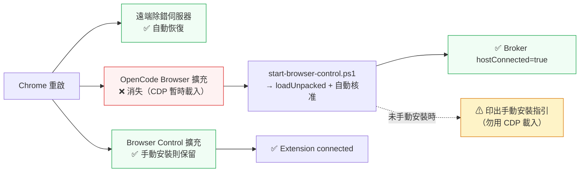

# opencode-browser — 控制使用者既有的瀏覽器

> **選軌與互斥**：本機同時存在五套瀏覽器／桌面自動化工具。要用哪一套、以及「**同一分頁同一
> 時間只能由一套持有**」的硬規則，見 [`browser-stack-routing`](../browser-stack-routing/SKILL.md)。
> 本軌的收尾動作是 `browser_release_tab`；未釋放會殘留 300 秒 claim 租約。

OpenCode Browser 是一個 **OpenCode 外掛**，讓 agent 直接驅動使用者**已經開著、已經登入**的
Chromium 家族瀏覽器。它不是另開一個乾淨的自動化瀏覽器，而是接管使用者現有的視窗與分頁。

> 與本收藏庫既有的 [`browser-control`](../browser-control/SKILL.md) 是**不同產品**：
> `browser-control` 是獨立 CLI + MCP（Playwright + relay + 擴充）；
> 本 skill 講的是 OpenCode 外掛 `@different-ai/opencode-browser`（native messaging + broker）。
> 兩者可並存，工具名不衝突（前者 `browser-control execute`，後者 `browser_*`）。

---

## 一、本機安裝狀態（2026-11-11 實測）

| 項目 | 實測值 | 判定 |
|---|---|---|
| 外掛套件 | `@different-ai/opencode-browser@4.6.1`（npm） | ✅ |
| OpenCode plugin | `~/.config/opencode/plugins/opencode-browser/`（**V2 移植版**，見 §四） | ✅ `opencode plugin list` 顯示 id `opencode-browser` |
| 註冊工具 | **24 支 `browser_*`**（見 §三） | ✅ 可在 OpenCode 內直接呼叫 |
| Broker | `~/.opencode-browser/broker.cjs`，socket `\\.\pipe\opencode-browser-<USER>` | ✅ |
| Native host | `~/.opencode-browser/native-host.cjs` + `host-wrapper.cmd` | ✅ |
| 登錄機碼 | Chrome / Chromium / Brave / Edge 四個 `NativeMessagingHosts` 金鑰 | ✅ |
| 擴充功能 | `~/.opencode-browser/extension`，ID `ncfalpcdanbcccbaakenefpokeioldgd`（manifest 內建 `key`，恆定） | ✅ 已載入使用者 Chrome |
| Broker 連線 | `Broker status: ok (hostConnected=true)` | ✅ |

**驗收指令**：

```powershell
npx.cmd @different-ai/opencode-browser@latest status
# 期待：Broker installed: true / Native host installed: true / Broker status: ok (hostConnected=true)
```

---

## 二、架構

```text
OpenCode agent
   │  browser_* 工具（外掛 dist/plugin.js → 本機 V2 包裝層 index.js）
   ▼
broker  ──── 具名管線 \\.\pipe\opencode-browser-<USER>
   │
   ▼
native messaging host（chrome.runtime.connectNative）
   │
   ▼
Chrome 擴充功能（OpenCode Browser Automation）
   │
   ▼
使用者的既有 profile（分頁、Cookie、已登入 session）
```

三個元件缺一不可：**外掛**（agent 端）、**native host + broker**（橋接）、**擴充功能**（瀏覽器端）。

### 重新安裝 / 修復

```powershell
# 1. 外掛與橋接（broker / native host / 登錄機碼）
npx.cmd @different-ai/opencode-browser@latest install
#    Step 3 要先在 Chrome 載入擴充功能才會繼續 → 可先用空白輸入跳過
#    Step 7 更新 opencode.json → 選「4) Skip」（避免覆寫既有設定）
#
# 2. 載入擴充功能到既有 Chrome（含自動核准 CDP 連線）
powershell -ExecutionPolicy Bypass -File scripts/start-browser-control.ps1
#
# 3. 驗證
npx.cmd @different-ai/opencode-browser@latest status
```

> **注意**：Step 7 若選 1/2/3，安裝器會寫入 `opencode.json`／`opencode.jsonc`，
> 可能覆寫本機既有設定（V1 的 `plugin` 欄位已 deprecated）。一律選 **「4) Skip」**。

---

## 三、工具清單（24 支）

| 類別 | 工具 |
|---|---|
| 分頁 | `browser_get_tabs`、`browser_open_tab`、`browser_close_tab`、`browser_claim_tab`、`browser_release_tab`、`browser_list_claims` |
| 導覽 | `browser_navigate` |
| 讀取 | `browser_query`、`browser_snapshot`、`browser_console`、`browser_errors`、`browser_status`、`browser_debug`、`browser_version` |
| 操作 | `browser_click`、`browser_type`、`browser_select`、`browser_scroll`、`browser_wait`、`browser_highlight` |
| 其他 | `browser_screenshot`、`browser_download`、`browser_list_downloads`、`browser_set_file_input` |

### CLI-first 偵錯（外掛未載入時仍可用）

```powershell
npx.cmd @different-ai/opencode-browser@latest tools              # 列出工具
npx.cmd @different-ai/opencode-browser@latest tool browser_get_tabs
npx.cmd @different-ai/opencode-browser@latest self-test          # 連線煙霧測試
```

> **單一 session 原則**：每次 `npx` 啟動都是**新的外掛 session**，分頁所有權（claim）
> 是 per-session 且租約 300 秒。跨多步驟的工作若每次都開新的 `npx`，會出現
> 「分頁被別的 session 佔住」。需要多步驟時，用
> [`scripts/browser-session.mjs`](scripts/browser-session.mjs) 維持**同一個 session**。

---

## 四、OpenCode V2 plugin 移植（本機自製，重要）

上游 `@different-ai/opencode-browser` 的 `dist/plugin.js` 是 **V1 格式**
（`export default async (ctx) => ({ tool: {...} })`），OpenCode V2 會拒絕載入：

```
failed to load plugin … cause="Plugin must export a default definition with an id and an effect or setup function."
```

V2 要求 default export 是**物件**，且同時有 `id` 與 `effect` 或 `setup`。

### 移植方式（已驗證可用）

| 檔案 | 角色 |
|---|---|
| `~/.config/opencode/plugins/opencode-browser/index.js` | **V2 包裝層**：`{ id, async setup(ctx) }`，於 `setup` 中呼叫 legacy factory，再以 `ctx.tool.transform(editor => editor.add(...))` 註冊 24 支工具 |
| `~/.config/opencode/plugins/opencode-browser/vendor/legacy.js` | 上游 bundle 原文（`export default` 為 V1 factory） |
| `~/.config/opencode/plugins/opencode-browser/package.json` | `exports: { ".": "./index.js" }` |

三個關鍵前提（皆實測確認）：

1. legacy factory **完全沒有用到 `ctx` 參數** → 可安全以 `{}` 呼叫。
2. 24 支工具的 `execute(args, ctx2)` **沒有任何一處使用 `ctx2` 的屬性** → V2 tool context 可直接透傳。
3. 工具參數型別只有 string / number / optional → zod → JSON Schema 用一支小轉換器即可
   （讀 `_zod.def.type`，optional 取 `_zod.def.innerType`），不必依賴 zod 的 `toJSONSchema`。

> `vendor/legacy.js` 必須放在子目錄：bundle 內 `PACKAGE_JSON_PATH = join(__dirname, "..", "package.json")`，
> 放在 plugin 根目錄會讀到錯誤路徑，`browser_version` 會回報 `version: "unknown"`。

---

## 五、Chrome 136+ 的遠端除錯限制（本機踩過，務必先讀）

Chrome 136 起，**`--remote-debugging-port` 對預設資料目錄一律被忽略**
（官方為防止竊密程式從預設 profile 撈 cookie）。要對「使用者既有的 Chrome」開遠端除錯，
**只能**走官方 UI：

1. Chrome 開啟 `chrome://inspect/#remote-debugging`
2. 勾選 **「Allow remote debugging for this browser instance」**
3. Chrome 會在 `127.0.0.1:9222` 啟動遠端除錯伺服器，並寫出
   `<userDataDir>\DevToolsActivePort`（第 1 行 port、第 2 行 browser websocket 路徑）

### approval 模式：每一條新連線都要核准

該模式下 Chrome 會對**每一條新的 CDP 連線**跳一次「允許遠端偵錯嗎？」對話框，
必須在連線建立期間按「允許」，連線才會完成。

```powershell
# 核准對話框（UIAutomation InvokePattern，非座標點擊）
powershell -ExecutionPolicy Bypass -File scripts/approve-remote-debug.ps1 -WaitSeconds 40
```

| 症狀 | 原因 | 處置 |
|---|---|---|
| `/json/version` 回 `404` | approval 模式下 HTTP 探索端點不開放 | 改用 `DevToolsActivePort` 的 browser websocket 路徑 |
| WebSocket 握手停滯不動 | 等待使用者核准 | 跑 `approve-remote-debug.ps1` 按「允許」 |
| 找不到「允許遠端偵錯嗎？」對話框 | UIAutomation 的 `RootElement` 取不到模態對話框 | 改用 Win32 `EnumWindows` 列舉視窗（腳本已實作） |

> **對話框標題是中文「允許遠端偵錯嗎？」**（英文環境為 "Allow remote debugging?"）。

### Chrome 重啟後會發生什麼（2026-11-11 實測）

| 項目 | 重啟後 | 說明 |
|---|---|---|
| 遠端除錯伺服器 | ✅ **自動恢復** | `Local State` 的 `devtools.remote_debugging.user-enabled` 跨重啟保留，不必重新勾選 |
| `DevToolsActivePort` | ✅ 重新寫入 | 但 browser uuid 會變（舊連線一律失效，需重新核准） |
| **OpenCode Browser 擴充** | ❌ **消失** | CDP `Extensions.loadUnpacked` 是**暫時載入**，不寫入 profile → 需重跑 `start-browser-control.ps1` |
| **Browser Control 擴充** | ✅ **若手動安裝則保留** | 見下方說明 |
| Chrome Web Store 安裝的擴充 | ✅ 不受影響 | 例如 BrowserSkill 0.4.2 |

> ⚠️ **Browser Control 擴充功能請用「一次性手動安裝」，不要用 CDP 載入。**
> CDP 載入的臨時實例處於**半註冊狀態**：`chrome.storage` 等 API 未初始化 →
> service worker 在握手時拋 `DOMException: InvalidAccessError` → 無限重連循環 →
> relay 端留下「Another browser or profile is already connected」(4004) 的殘留註冊，
> 之後所有連線一律被拒。
> **正確做法**（一次性，之後 Chrome 重啟也不會消失）：
>
> 1. Chrome 開啟 `chrome://extensions`
> 2. 右上角開啟「開發者模式」
> 3. 點「載入未封裝項目」，選擇
>    `%APPDATA%\npm\node_modules\@opencode-ai\browser-control\extension\dist`
> 4. 載入後工具列圖示出現，relay 便會自動連線（`browser-control status` → `Extension: connected`）

**一鍵復原 OpenCode Browser 擴充 + 檢查兩套工具狀態**：

```powershell
powershell -ExecutionPolicy Bypass -File scripts/start-browser-control.ps1
```



### CDP 端點取得順序（`scripts/load-extension.mjs` 已實作）

1. `GET http://127.0.0.1:<port>/json/version`（一般 `--remote-debugging-port` 啟動時可用）
2. `<userDataDir>\DevToolsActivePort` 第 2 行 → `ws://127.0.0.1:<port><path>`

---

## 六、與 browser-control 的差異

| 面向 | browser-control | opencode-browser（本 skill） |
|---|---|---|
| 橋接方式 | Chrome 擴充 + 本機 relay（`127.0.0.1:19989` HTTP/WS） | Chrome 擴充 + **native messaging** + 具名管線 broker |
| 分頁所有權 | session 擁有 relay 建立的頁；`adopt` 使用者頁 | **per-tab claim**，租約 300 秒 |
| 元素定位 | `ref("e12")` 穩定 ref（DOM drift fail-closed） | CSS selector（擴充的 `deepQuerySelectorAll` 可穿 shadow DOM） |
| 執行自由度 | Playwright 任意 JS | 24 支固定工具 + raw CDP 逃生門 |
| 憑證遮蔽 | ✅ HAR + Secret Profile | ❌ 無 |
| 錄影 / 截圖 diff | ✅ | 僅 screenshot |
| 人機協作 | ✅ `handoff()` + `demonstrate()` | 頁面可見、使用者可接手 |

---

## 七、實戰配方：重排 YouTube 播放清單

完整步驟與演算法見 [`reference/youtube-playlist-reorder.md`](reference/youtube-playlist-reorder.md)。
摘要：

1. **排序下拉**：公開播放清單頁頂端的 chip（顯示「手動」）→ 選項有
   手動／新增日期(最新·最舊)／最熱門／發布日期(最新·最舊)。
   「發布日期 (最舊)」可快速取得近似順序。
2. **每列動作選單**：⋮ → 「移至頂端」「移至底部」「設為播放清單縮圖」。
3. **重排演算法**：想得到目標順序，就**依目標順序的相反順序**逐筆「移至頂端」。
   每一筆搬到頂端會把其餘往後推，因此反向搬移的結果正好是目標順序。
4. **逐筆驗證**：每搬一次就重讀一次清單順序，不要相信「已點擊」。

---

## 八、踩過的坑

| 坑 | 症狀 | 解法 |
|---|---|---|
| Chrome 137+ 移除 `--load-extension` | 擴充功能沒出現、broker `hostConnected=false` | 用 CDP `Extensions.loadUnpacked`（`scripts/load-extension.mjs`） |
| Chrome 136+ 忽略預設 profile 的 `--remote-debugging-port` | 遠端除錯埠無反應 | 改用 `chrome://inspect/#remote-debugging` 勾選啟用 |
| approval 模式每條連線都要核准 | WS 握手停滯 | 跑 `scripts/approve-remote-debug.ps1` |
| UIAutomation 取不到模態對話框 | `RootElement` 找不到標題 | Win32 `EnumWindows` + `AutomationElement.FromHandle` |
| 上游 plugin 是 V1 函式格式 | `Plugin must export a default definition with an id and an effect or setup function` | 本機 V2 包裝層（§四） |
| `vendor/legacy.js` 位置錯誤 | `browser_version` 回 `version: "unknown"` | 放在 `vendor/` 子目錄，讓 `__dirname/..` 指向 plugin 根 |
| 擴充功能載入後連線中斷 | `hostConnected=false` | 在 service worker 執行 `chrome.runtime.reload()`；擴充每 15 秒有 keepalive alarm 會重連 |
| 分頁全部消失 | 重啟 Chrome 未開啟工作階段還原 | `session.restore_on_startup=1`，事後還原 |
| `npm.ps1` 被執行原則擋下 | `npm : 無法辨識…` | 用 `npm.cmd` |
| PowerShell 5.1 把 JSON 的雙引號吃掉 | 傳給 node 的參數變成 `{selector:abc}` | JSON 參數寫進**檔案**再讀取 |
| 主控台編碼把中文輸出弄亂 | 讀到的中文是亂碼 | 結果寫成 UTF-8 檔案，用編輯工具／Node 讀取 |
| 程式化 `.click()` 開不了選單 | 選單沒出現 | 改送 CDP Input 真實滑鼠事件 |
| 用截圖座標點擊 | 點到別的影片／欄位 | 一律用 `getBoundingClientRect()` |
| 每步驟開新的 `npx` | 分頁被別的 session 佔住 | 維持單一 session（`browser-session.mjs`） |
| 在 Studio 新版找不到排序功能 | 舊版 `/playlist?list=` 編輯器已停用（錯誤頁） | 排序下拉在新版公開播放清單頁的 chip |

---

## 九、相關檔案

| 檔案 | 用途 |
|---|---|
| [`scripts/start-browser-control.ps1`](scripts/start-browser-control.ps1) | 載入擴充功能 + 自動核准 CDP 連線 + 驗證 broker |
| [`scripts/approve-remote-debug.ps1`](scripts/approve-remote-debug.ps1) | 核准 Chrome 的「允許遠端偵錯嗎？」對話框 |
| [`scripts/load-extension.mjs`](scripts/load-extension.mjs) | CDP `Extensions.loadUnpacked`（支援 DevToolsActivePort 回退） |
| [`scripts/browser-session.mjs`](scripts/browser-session.mjs) | 維持單一 session 的工具執行器（檔案佇列） |
| [`reference/extension-loading.md`](reference/extension-loading.md) | Chrome 137+ 限制、擴充功能 ID 計算、分頁還原細節 |
| [`reference/youtube-playlist-reorder.md`](reference/youtube-playlist-reorder.md) | YouTube 播放清單排序機制與重排演算法 |
