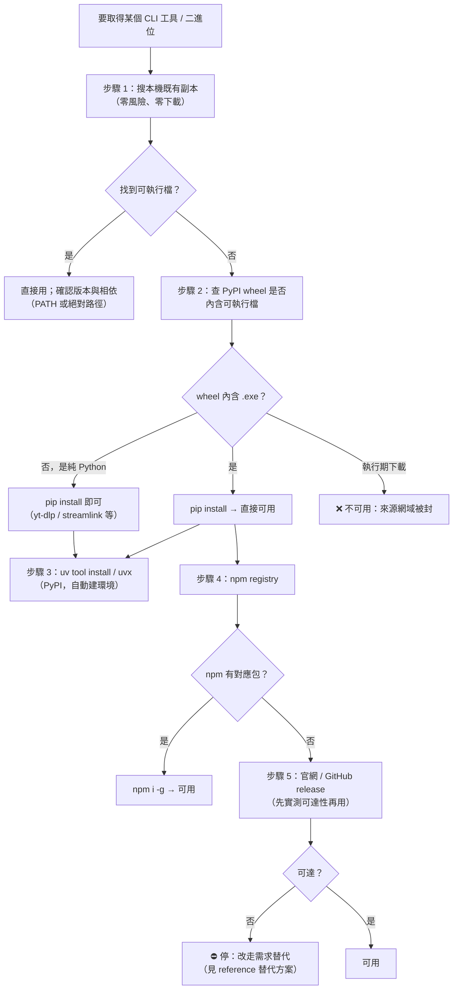

# py-binary-deps — 本機二進位工具取得管道

本機位於**受公司代理管制的網路**：對外流量必須走代理、僅 TCP 443、網域採**個別白名單**。
結果是「官網下載」與「GitHub release 資產」這兩條最直覺的取得管道經常不可用，
而 **npm / PyPI / npmmirror 這三條卻是通的**。

本 skill 給出**已實測**的取得管道與決策順序，避免每次都從頭試錯。

---

## 黃金法則：取得順序（由快到慢，由可靠到不可靠）



**核心提醒**：多數人直接跳到步驟 5，結果卡在 000。**永遠先做步驟 1 與 2。**

---

## 步驟 1：先搜本機既有副本

本機經常已經有多份同名工具（不同版本、來自不同專案）。搜尋成本低、風險最低。

```powershell
Get-ChildItem -Path C:\Users\<USER>, D:\Downloads, D:\80-Opnecode -Recurse `
  -Include ffmpeg.exe, ffprobe.exe, node.exe, yt-dlp.exe, aria2c.exe -File -ErrorAction SilentlyContinue |
  Select-Object FullName, @{n='MB';e={[math]::Round($_.Length/1MB,1)}}, LastWriteTime
```

找到後**務必驗版本**，不要只看檔名：

```powershell
& "<找到的路徑>\ffmpeg.exe" -version | Select-Object -First 1
```

> 本機實例（2026-10-22）：`C:\Users\<USER>\ffmpeg\ffmpeg-9.0.1-essentials_build\bin\ffmpeg.exe`
> = **ffmpeg 9.0.1**（126 encoders / 294 decoders）——比 PyPI 能取得的 7.1 更新兩個大版本。

---

## 步驟 2：判斷 PyPI 套件是「wheel 內含」還是「執行期下載」

這是本 skill 最核心的判斷。兩者在 `pip install` 時的行為天差地別。

| 類型 | 行為 | 本機可用性 |
|---|---|---|
| **wheel 內含 .exe** | 安裝完就有可執行檔 | ✅ 可用 |
| **純 Python**（0 二進位） | 本身就是 Python 程式 | ✅ 可用（CLI 以 `python -m xxx` 呼叫） |
| **執行期下載** | 安裝時或首次執行時去官網／GitHub release 抓 | ❌ **不可用**（來源網域被封） |

### 判斷方法（下載 wheel 後解壓檢視，不需安裝）

```powershell
py -3 -m pip download --no-deps --only-binary :all: -d <暫存目錄> <套件名>
# 再用 Python 讀 wheel 內容，列出 .exe/.dll/.pyd
```

完整可執行腳本見 `reference/probe-recipes.md`（含「自動判別 wheel 內含 / 執行期下載」的一次性腳本）。

### 已知「執行期下載 → 不可用」的套件

| 套件 | 下載來源 | 判定 |
|---|---|---|
| `static-ffmpeg` | `github.com/zackees/ffmpeg_bins/raw/main/...` | ❌ 網域被封 |
| `ffmpeg-downloader` | `api.github.com/repos/BtbN/FFmpeg-Builds`、`www.gyan.dev` | ❌ 網域被封 |

---

## 步驟 3：uv —— 本機最順手的工具取得器

`uv` 本身在 PyPI 上（wheel **內含** `uv.exe` / `uvx.exe`），所以在封鎖環境仍可安裝。
**本機已全域安裝**：`C:\Users\<USER>\.local\uv\bin\uv.exe`（已加入使用者層 PATH，uv 0.13.5）。

```powershell
uv --version                   # 0.13.5
uv tool install ruff            # ✅ 走 PyPI → 產生 ruff.exe
uvx ruff --version              # ✅ 一次性執行（免安裝，實測 1.16s）
uv tool install --python 3.13 <pkg>      # 用既有直譯器
```

### uv 的兩條界線（實測）

| 功能 | 可用 | 原因 |
|---|---|---|
| `uv tool install` / `uvx`（從 PyPI 裝工具） | ✅ | 只走 PyPI |
| `uv python install 3.13`（裝 Python 直譯器） | ❌ | 需 `github.com/astral-sh/python-build-standalone/releases/...` → 被封；且 rustls 不信任公司 CA |

### uv 的 TLS 陷阱

`uv` 用 rustls + webpki 根憑證，**不讀 Windows 憑證存放區** → 不信任公司的 MITM CA。
Node / pip / curl 用 Windows 憑證存放區 → 信任公司 CA。
所以「同一個網域，pip 行、uv 不行」是正常現象，不是網路問題。

### ⚠️ `uv pip sync` 的破壞性陷阱（實測確認）

`uv pip sync` 會把環境**精確對齊**來源檔。**寬鬆的 requirements.txt 會導致相依套件遺漏**：

```powershell
# requirements.txt 只有一行 "requests"
uv pip sync requirements.txt --python <venv>   # ❌ 只裝 requests，urllib3 沒裝 → ModuleNotFoundError
pip install -r requirements.txt                # ✅ 完整相依樹
uv pip install -r requirements.txt             # ✅ 完整相依樹
```

**規則**：`uv pip sync` 只能搭配**完全釘選**的來源檔（`uv pip compile` 產出的 requirements.txt 或 `pylock.toml`）；
專案層級請用 `uv sync`（消費 `uv.lock`，不要把 `uv.lock` 丟給 `uv pip sync` —— 格式不相容）。

### uv 與 pip 的功能重疊速查

| 用途 | 建議 |
|---|---|
| 一次性跑個工具 | `uvx <tool>`（實測 1.16s） |
| 隔離安裝 CLI 工具 | `uv tool install <tool>`（取代 pipx） |
| 新專案、需要 lockfile | `uv init` + `uv add` + `uv sync` |
| 只是一般裝套件想快一點 | `uv pip install -r req.txt`（相依樹與 pip 等價，實測 4–10× 快） |
| 企業私有 index / 怪異 sdist / 需要非 PyPI 來源 | **維持 pip** |

完整重疊地圖、實測 benchmark 與陷阱詳解見 `reference/uv-vs-pip.md`。

---

## 步驟 4–5：npm 與官網

```powershell
npm i -g <套件>          # ✅ registry.npmjs.org 可達
```

官網 / GitHub release **先實測再下載**：

```powershell
curl.exe -s -o NUL -w "%{http_code}" -x $env:HTTPS_PROXY --max-time 15 https://<網域>/
# 000 = 封鎖；401/403 = 通（僅來源端拒絕匿名）；2xx/3xx = 通
```

---

## 本機網域可達性（2026-10-22 實測，非推測）

| 網域 | 狀態 | 影響 |
|---|---|---|
| `pypi.org`、`files.pythonhosted.org` | ✅ 200 | **二進位取得的首選管道** |
| `registry.npmjs.org` | ✅ 200 | npm 套件可裝 |
| `cdn.npmmirror.com` | ✅ 200 | node / electron 等二進位鏡像 |
| `github.com`、`api.github.com`、`raw.githubusercontent.com`、`codeload.github.com` | ✅ 200 | 可抓原始碼／tarball |
| `cdn.winget.microsoft.com` | ✅ 200 | ⚠️ 但 winget 只掛 `msstore` 來源 → 官方來源條目裝不了 |
| **`objects.githubusercontent.com`、`release-assets.githubusercontent.com`** | ❌ 000 | **GitHub release 資產一律抓不到** |
| **`ffmpeg.org`、`www.gyan.dev`** | ❌ 000 | FFmpeg 官網與 Windows 預編譯首選不可達 |
| **`nodejs.org`** | ❌ 000 | 裝 Node 須改用 npmmirror 鏡像 |
| `mirrors.aliyun.com/nodejs-release`、`mirrors.tuna.tsinghua.edu.cn/nodejs-release` | ❌ 000 | 僅 npmmirror 可用 |

> 網域清單會變。**換設備或換網路後必須重新實測**，不可沿用本表。

---

## 工具 → 管道對照表（已實測）

| 工具 | 本機可用管道 | 備註 |
|---|---|---|
| **ffmpeg / ffprobe** | ① 本機既有 `ffmpeg-9.0.1-essentials_build` ② PyPI `imageio-ffmpeg`（內含 7.1） | 需 ffmpeg ≥ 5.0（`-fps_mode`） |
| **yt-dlp** | `py -3 -m pip install yt-dlp` | **純 Python**，不需要 .exe；只在合併 video+audio 時才呼叫外部 ffmpeg |
| **node / npm** | `nvm` + `NVM_NODEJS_ORG_MIRROR=https://cdn.npmmirror.com/binaries/node` | 官網被封 |
| **uv / uvx** | `py -3 -m pip install uv` | wheel 內含 `uv.exe`；`uv tool install` 可用，`uv python install` 不可用 |
| **ruff** | `uv tool install ruff` | wheel 內含 `ruff.exe` |
| **aria2c** | `pip install aria2` | wheel 內含 `aria2c.exe` |
| **playwright driver** | `pip install playwright` | wheel 內含 `node.exe`（v24.x）；但 `playwright install chromium` 仍需下載瀏覽器 → 被封 |
| **streamlink / gallery-dl / sqlmap / pipx** | `pip install <pkg>` | 純 Python，安裝即用 |
| **PyAV（FFmpeg 函式庫）** | `pip install av` | 內含 libav* 函式庫，**但沒有 ffmpeg CLI** |
| **Windows VC++ 執行階段庫** | `pip install msvc-runtime` | 內含 23 個 DLL |
| **poppler / tesseract / ImageMagick** | ❌ 無可靠 PyPI 內含管道 | 需申請放行官網，或找既有攜帶版 |

---

## 常見誤區

| 誤區 | 事實 |
|---|---|
| 「GitHub 能開就代表 release 資產抓得到」 | ❌ `github.com` 通，但 `release-assets.githubusercontent.com` 被封 → **只有網頁通，資產不通** |
| 「yt-dlp 需要 yt-dlp.exe」 | ❌ 官方 wheel 是純 Python；`.exe` 只是給沒有 Python 的人用的單檔版本 |
| 「套件名稱有 ffmpeg 就能取代 ffmpeg CLI」 | ❌ `pyffmpeg`、`ffmpeg-python` 只是 wrapper，仍需系統有 ffmpeg CLI |
| 「pip 裝得起來就代表能用」 | ⚠️ 執行期下載型的套件安裝成功但執行會失敗 |
| 「uv 比較新所以比較會連線」 | ❌ uv 的 rustls 不信任公司 CA，比 pip 更難連非 PyPI 來源 |

---

## 安裝後必做的驗證

```powershell
# 1. 版本真的可執行（不要只看檔案存在）
<tool> --version
# 2. 依賴是否齊全（例如 yt-dlp 需要 ffmpeg 合併時）
<tool> --help | Select-String ffmpeg
# 3. 若是被長駐程序呼叫（relay / MCP），必須重啟該程序才會套用新的 PATH
```

> **PATH 變更對長駐程序無效**：程序啟動時繼承環境變數快照。
> 例：`browser-control` 的 relay 是長駐程序 → 換掉 ffmpeg 路徑後必須
> `browser-control relay restart`，否則錄影仍會報 `spawn ffmpeg ENOENT`。

---

## 相關 skill

| skill | 關聯 |
|---|---|
| `video-analysis` | 需要 ffmpeg / ffprobe 做影片處理（其 skill 內的路徑需與本 skill 對齊） |
| `yt-batch-download` | 需要 yt-dlp + ffmpeg 合併 |
| `browser-control` | CDP 錄影需要 ffmpeg ≥ 5.0 在 PATH |
| `web-tools` | 網域可達性與擷取管道的既有慣例 |

---

## 附錄檔案

| 檔案 | 內容 |
|---|---|
| `reference/channel-catalog.md` | 完整套件盤查表（含 wheel 檔案數、二進位數、執行期下載來源）與實測證據 |
| `reference/probe-recipes.md` | 可直接執行的探測／安裝／驗證腳本 |
| `reference/uv-vs-pip.md` | uv 與 pip 的功能重疊地圖、本機實測 benchmark、`uv pip sync` 陷阱與遷移建議 |
